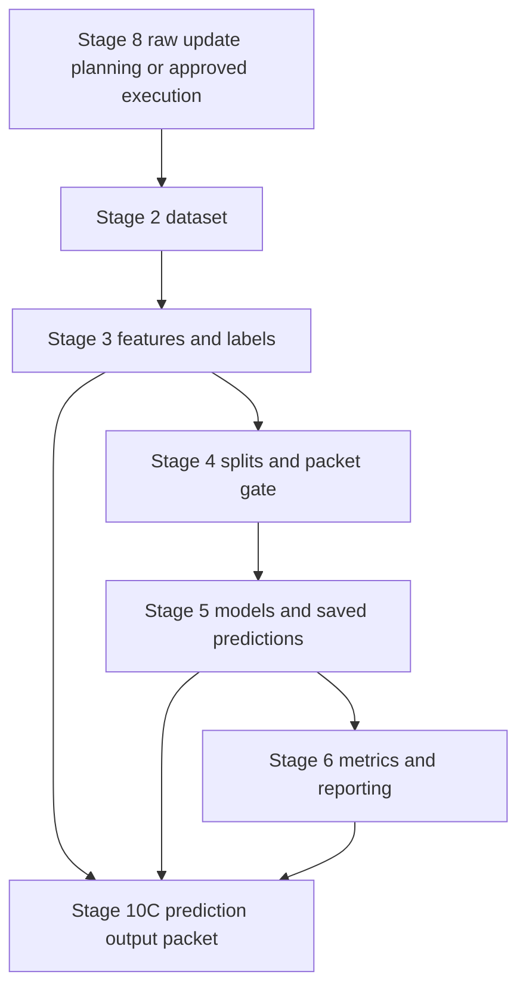
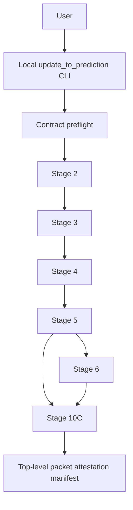
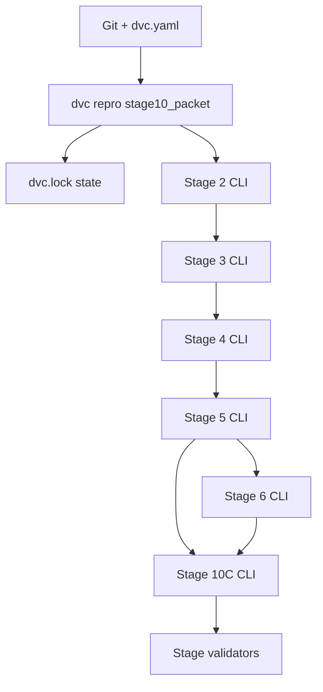
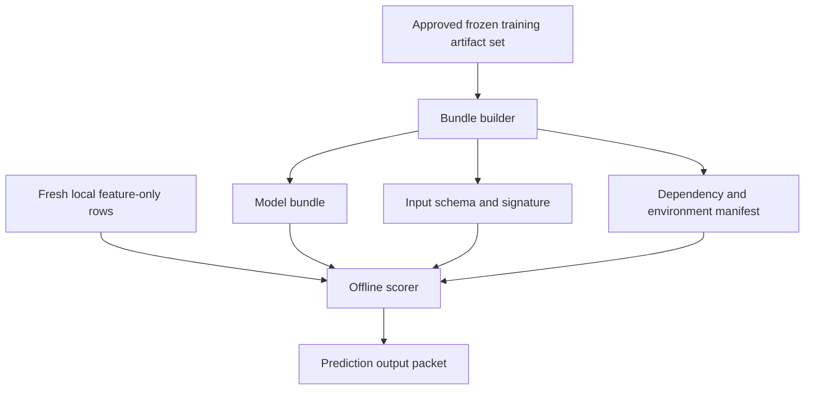
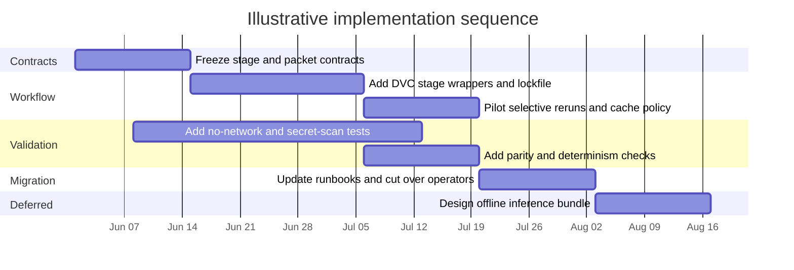

# Decision Ready Memo for the Future Local Update To Prediction Pipeline Architecture

GitHub connector used: `GitHub` → `ValdiviaEng/financial-event-state-forecasting`.

## Executive summary

The repository is already much closer to a governed, artifact-first research system than to an ad hoc script collection. It defines itself as a local CLI/artifact-driven research system rather than a service/API/dashboard; it has materialized and validated Stage 2 through Stage 6 benchmark artifacts; Stage 5 stores saved out-of-sample predictions with explicit row/version metadata; Stage 8 raw refresh tooling is plan-first and manifest-backed by default; and Stage 10C generates a validation-gated local packet from existing Stage 5 saved predictions plus Stage 3 and Stage 6 context. The current serious benchmark result remains `clean_null` with `limitation_bearing` comparability. fileciteturn5file0L3-L3 fileciteturn6file0L3-L3 fileciteturn7file0L3-L3 fileciteturn19file0L3-L3 fileciteturn30file0L3-L3

The main architectural weakness is not missing packet discipline; it is missing **executable orchestration and packaged inference**. The runbooks explicitly say there is no approved one-command end-to-end rebuild path, and the current Stage 10C implementation only emits `historical_prediction` outputs from existing validation/lockbox saved predictions. It does **not** define persisted fitted-model serving, approved `forecast_candidate` semantics, or arbitrary feature-only future-row scoring. fileciteturn6file0L3-L3 fileciteturn16file0L3-L3 fileciteturn23file0L3-L3 fileciteturn27file0L3-L3 fileciteturn29file0L3-L3

The decision I recommend is to **approve Option B as the target architecture**: a **local lockfile-backed DAG wrapper around the existing stage CLIs and validators**, implemented after a short Option A hardening phase. This is the best fit because it preserves the repository’s current governance boundary, keeps Stage 8 plan-first by default, improves reproducibility and selective reruns, and makes provenance auditable at the workflow level through explicit dependency/state capture. By contrast, a true offline inference bundle should be **deferred** until there is separate approval for future-row semantics and model packaging, because mainstream scikit-learn persistence comes with security and version-compatibility constraints, and schema-validated model bundles require more metadata and validation work than the current repository has approved. fileciteturn5file0L3-L3 fileciteturn6file0L3-L3 citeturn3view1turn12view0turn2view0turn6view0turn7view2

## Current repository state and present pipeline

The current project identity is clear and consistent across the runbooks and project-definition files: it is a **local artifact-driven forecasting research system**, with the first serious benchmark frozen around forward excess returns, five horizons (`1d`, `5d`, `10d`, `20d`, `60d`), top-50 universe control, same-day-as-of-close alignment, purged-plus-embargoed walk-forward evaluation, and saved-prediction-based reporting. The repo also already separates benchmark evidence from downstream output packets, which is a strong governance choice. fileciteturn34file0L3-L3 fileciteturn18file0L3-L3 fileciteturn19file0L3-L3 fileciteturn10file0L3-L3

The present local flow, as evidenced by `ExecutionPipeline.md`, `UsageManual.md`, and the Stage 10C implementation, is:

That flow is stagewise and explicit, not monolithic. The runbooks state that a safe run means selecting the correct mode, confirming approvals, running the right stage commands, validating each artifact boundary, and updating documentation/memory when evidence changes. They also say there is intentionally **no approved one-command full-pipeline command** at present. fileciteturn6file0L3-L3

Stage 8 is already designed with the right safety instincts for a local artifact-driven pipeline. The shared Stage 8 helper builds manifest-backed plans, marks default status as `planned_only`, writes a `refresh_impact_note` warning that raw updates may require Stage 2-6 rebuilds and comparability review, preserves existing raw files unless overwrite is explicit, records redacted ledger paths, normalizes provider symbols only at the provider boundary, and includes non-claims that the plan is not a benchmark result or trading signal. The contract tests explicitly assert that plan mode makes no provider calls, that existing files are skipped by default, that dotted tickers such as `BRK.B` are preserved in storage while mapped to provider request symbols, and that API keys/URLs are redacted from shareable outputs. fileciteturn17file0L3-L3 fileciteturn25file0L3-L3 fileciteturn26file0L3-L3 fileciteturn32file0L3-L3

Upstream artifact discipline is also already strong. The Option B leakage-control contract requires stable row identity, split manifests, fold-local preprocessing, saved out-of-sample predictions, contamination blockers, overfitting diagnostics, and a full serious-run artifact packet. Stage 4 materializes the split and artifact-packet gate; Stage 5 stores a schema-governed saved-prediction artifact with required row/version columns and only `validation` or `lockbox` split roles; and Stage 6 computes metrics, ranking diagnostics, paired comparisons, and comparison summaries from those predictions. fileciteturn18file0L3-L3 fileciteturn19file0L3-L3 fileciteturn23file0L3-L3

Stage 10C then turns that evidence into a readable packet. The implementation reads `saved_predictions.parquet`, Stage 3 feature artifacts, and Stage 6 evaluation/comparison manifests; it writes a packet with a manifest, parquet/CSV tables for model outputs and top-10 views, relevant-news context, trajectory points, `limitations.json`, `report.html`, and `validation_report.json`; and it performs fail-closed validation for required files, row-role semantics, horizon coverage, ranking limits, sensitive-artifact exclusion, no-URL relevant-news output, and no projected price path. The current documented packet size is meaningful enough to show that this is real packetization rather than a stub: `250` model-output rows, `50` primary top-10 rows, `50` delta rows, `10` cross-horizon rows, `86` relevant-news rows, and `449` trajectory rows. fileciteturn27file0L3-L3 fileciteturn28file0L3-L3 fileciteturn29file0L3-L3 fileciteturn30file0L3-L3 fileciteturn31file0L3-L3 fileciteturn5file0L3-L3

What the current repo **does not** do is equally explicit. The packet row role is `historical_prediction`, not `forecast_candidate`; the packet is not trading advice, not a benchmark result, not a Stage 6 reinterpretation, not a service/API/dashboard output, and not a persisted inference package; and the runbooks state there is no persisted fitted-model serving path for arbitrary new feature-only rows. That means the current “update-to-prediction” flow is a **governed historical packet-generation flow**, not yet a true offline future-scoring architecture. fileciteturn5file0L3-L3 fileciteturn10file0L3-L3 fileciteturn16file0L3-L3 fileciteturn27file0L3-L3 fileciteturn29file0L3-L3

## Gap analysis against artifact driven local pipeline best practices

On best-practice criteria, the repository is strong on **leakage control, saved-prediction auditability, and packet non-claims**, but weaker on **workflow-level reproducibility, environment capture, and future inference packaging**. FAIR principles explicitly state that the relevant principles apply not only to data, but also to the algorithms, tools, and workflows that produce data, which means workflow-level metadata and reproducibility matter here, not just per-stage output manifests. The leakage literature also supports the repo’s emphasis on stable row identity and saved out-of-sample predictions, while ML-systems engineering literature emphasizes versioned inputs, explicit dependency analysis, and control of hidden consumers. fileciteturn18file0L3-L3 fileciteturn19file0L3-L3 citeturn13view0turn8academia0turn11view0

| Dimension | Current repository state | Gap versus best practice | Why it matters |
|---|---|---|---|
| Workflow orchestration | Strong stage contracts and validators, but no approved one-command DAG or lockfile-backed workflow state. fileciteturn6file0L3-L3 | No executable, version-controlled dependency graph equivalent to `dvc.yaml`/`dvc.lock`, and no evidence in the reviewed sources of a workflow-level environment lock. fileciteturn5file0L3-L3 citeturn3view1turn12view0turn2view0 | Selective reruns, exact state capture, and operator ergonomics remain more procedural than declarative. |
| Leakage and comparability | Excellent by research-pipeline standards: stable row identity, purge/embargo, untouched lockbox, fold-local preprocessing, saved OOS predictions, contamination blockers. fileciteturn18file0L3-L3 | One declared diagnostic remains blocked because Stage 5 intentionally did not save train predictions; broader workflow dependency drift is still documented more than mechanized. fileciteturn19file0L3-L3 | The repo is scientifically careful, but not yet maximally operationally reproducible. |
| Packet metadata | Stage 10C already writes manifest, counts, non-claims, limitations, and static report artifacts. fileciteturn27file0L3-L3 fileciteturn29file0L3-L3 | It still stops short of a model-card/datasheet-style package describing intended use, training snapshot, environment, and explicit reuse constraints in a standardized machine-readable contract. citeturn4academia2turn5academia0turn13view0 | Distribution and later reuse become safer when packet metadata is standardized and richer. |
| Offline execution and secrets | Stage 8 defaults to no provider call, redacts secrets, and preserves raw files safely; Stage 10C excludes ledgers/logs/URLs. fileciteturn25file0L3-L3 fileciteturn26file0L3-L3 fileciteturn29file0L3-L3 fileciteturn32file0L3-L3 | The reviewed materials do not evidence a workflow-level “no-network” integration test for the whole update-to-prediction path. | Documentation says “no provider calls” by default; a stronger future architecture should make that mechanically testable path-wide. |
| Future-row inference | Explicitly absent today: current Stage 10C is historical saved-prediction extraction only. fileciteturn16file0L3-L3 fileciteturn27file0L3-L3 | No packaged model + preprocessor + schema + dependency bundle for true future feature-only scoring. | This is the single biggest blocker if the future objective becomes “score new rows offline without rebuilding evaluation splits.” |

Two gaps dominate the decision. The first is **workflow-level reproducibility**. DVC’s pipeline model is explicitly built around a declarative stage graph and a lockfile that captures dependencies, parameters, and outputs for reproduction and selective reruns; Snakemake offers a similarly reproducible workflow layer plus portable reports and environment descriptions. The second is **safe packaged inference**. MLflow’s model signatures and metadata show how to specify input/output contracts and dependency files, while scikit-learn’s own documentation warns that pickle-based persistence can execute arbitrary code, requires matching dependency versions, and should be accompanied by saved references to immutable training data, source code, and dependency metadata. citeturn3view1turn12view0turn6view0turn7view1turn7view2turn2view0

A final point is that the repo’s current leakage posture is already stronger than basic mainstream time-series tooling. Scikit-learn’s `TimeSeriesSplit` exposes a `gap` parameter to exclude observations immediately before the test window, while this repo goes further by explicitly recording purge and embargo spans at the manifest level, using the maximum approved label horizon as the default policy, and separating a final lockbox for reporting only. That is a strength to preserve, not something to redesign away. fileciteturn18file0L3-L3 fileciteturn22file0L3-L3 citeturn3view0

## Architecture options

All three options below preserve the repository’s local-only boundary, keep Stage 8 plan-first unless live execution is separately approved, and preserve the distinction between benchmark evidence and downstream readable packets. The real tradeoff is between **minimal disruption**, **workflow reproducibility**, and **true future-row inference**. fileciteturn15file0L3-L3 fileciteturn16file0L3-L3

| Option | Core idea | Pros | Cons | Required changes | Effort | Main risks |
|---|---|---|---|---|---|---|
| **Option A** | Keep the current stagewise architecture, but add one governed offline orchestrator CLI plus a top-level run manifest. | Lowest disruption; easiest migration; preserves current docs and validator model. | Still lacks a true lockfile/state graph; selective reruns remain procedural. | New orchestrator CLI, top-level run manifest, no-network integration tests, packet attestation step. | **Low** | Command sprawl; drift between docs and orchestration logic. |
| **Option B** | Wrap existing Stage 2-10 commands in a local DVC-style DAG with lockfile-backed state and explicit dependencies. | Strong reproducibility, selective reruns, Git-trackable state, easy audit trail. | Adds another abstraction layer and some duplicated metadata. | `dvc.yaml`, `dvc.lock`, stage wrappers, local cache policy, environment capture, validator gates. | **Medium** | Operator learning curve; metadata duplication if not carefully scoped. |
| **Option C** | Add a persisted offline inference bundle for feature-only future-row scoring, plus packet generation. | Only option that truly enables future-row local scoring without relying on Stage 5 saved predictions. | Highest governance, packaging, security, and schema burden; requires new approvals. | Bundle builder, schema/signature contract, dependency manifests, secure serializer/runtime, future-row validators. | **High** | Packaging a custom estimator safely; environment/version drift; scope creep into a quasi-serving system. |

**Option A — Governed offline orchestrator on top of the current stage CLIs**

This option keeps the present design philosophy intact and hardens it. The orchestrator would consume explicit artifact roots, optionally consume Stage 8 **plan manifests** as upstream evidence, run only approved local stages, deny network access in offline mode, and emit a top-level run record that points to every downstream artifact and validator. That would close the most immediate ergonomics gap while preserving the repo’s current governance vocabulary and existing validators. fileciteturn6file0L3-L3 fileciteturn17file0L3-L3 fileciteturn31file0L3-L3

The migration would be straightforward: first freeze stage input/output contracts; then add a single orchestrator CLI and config; then add end-to-end no-network tests and a top-level packet attestation JSON that records stage roots, validator results, and the current non-claims. The weakness is structural: this still leaves reproducibility dependent on custom orchestration logic rather than on a standard lockfile/state mechanism, which means it improves operations more than reproducibility. That is why I view it as a bridge, not the target state. citeturn3view1turn11view0

**Option B — DVC lockfile DAG around existing stages**

This is the best match to the repository’s current structure. DVC’s documented model is explicitly Git-centric: pipeline stages live in `dvc.yaml`, `dvc repro` executes the dependency graph, and `dvc.lock` records the exact dependency/parameter/output state and should be committed to Git to preserve the current results. That maps cleanly onto a repository that already has stagewise CLIs, validated artifact roots, named manifests, and folder digests. citeturn3view1

The key architectural benefit is that the repo’s existing artifact contracts remain authoritative, while workflow state becomes executable and reproducible at the DAG level. Unchanged stages can be skipped automatically, changed dependencies become visible in one place, and stage promotion from Stage 2 through Stage 10C becomes easier to audit. In effect, this reduces the “hidden dependency” and “versioned signal” risks that Sculley et al. identified for ML systems, without forcing an immediate jump to packaged online-style inference. fileciteturn18file0L3-L3 fileciteturn19file0L3-L3 citeturn11view0turn3view1

A close alternative here would be Snakemake. Its documentation correctly emphasizes reproducible and scalable workflows, environment descriptions, and portable reports. But for **this** repository, DVC is the closer fit because the repo is already organized around explicit artifact directories and Git-tracked stage outputs rather than around a need for a more expressive workflow DSL. Snakemake becomes more compelling if the future pipeline grows many dynamic branch rules or needs richer rule-level reporting; today, DVC is the simpler and more native move. citeturn12view0

Migration would be medium effort: wrap each existing stage CLI as a DVC stage; mark validator scripts as hard gates; track artifact roots and resolved configs as dependencies/outputs; preserve Stage 8 live execution outside the DAG unless provider calls are separately approved; and add an environment-lock story alongside the DAG so the pipeline’s software state is reproducible, not just its file dependencies. citeturn3view1turn2view0

**Option C — Persisted offline inference bundle for true future-row scoring**

This option is the only one that truly changes the repo from **historical saved-prediction packet generation** into **future-row offline scoring**. It would require a packaged model/preprocessor boundary, a strict feature schema, explicit dependency and environment metadata, and new approved semantics for `forecast_candidate` rows. The right conceptual templates here are MLflow-style model signatures and metadata files for input/output contracts and dependency capture, plus scikit-learn’s own guidance that persisted models need version-matched environments and additional saved metadata beyond the bare model object. citeturn6view0turn7view2turn2view0

This option is also the riskiest. The repo’s main event-state model is a custom `simple_gated_fusion` model (`event_state_gated_fusion`), not a pure stock estimator roster, so ONNX conversion is likely to be non-trivial; scikit-learn’s documentation explicitly warns that not all models are supported by ONNX and that custom estimators require more work, while pickle/joblib/cloudpickle are unsafe to load from untrusted sources and are unsupported across version drift. For a local-only repo, that means future inference packaging must be paired with a very explicit security and environment story, otherwise it becomes a fragile hidden-dependency layer. fileciteturn23file0L3-L3 citeturn2view0

If this option is ever approved, I would not start with “just pickle the model.” I would start with an explicit schema/signature, immutable references to the training snapshot, dependency lockfiles, local validation of bundle execution, and packet metadata that follows a model-card/datasheet style for intended use and limitations. Without those, Option C is too easy to misread as a lightweight extension when in practice it is a new subsystem. citeturn6view0turn7view1turn7view2turn4academia2turn5academia0

## Recommended architecture and implementation roadmap

The recommended target state is **Option B**, implemented in two phases: first a short **Option A-style hardening phase** to freeze packet and stage contracts, then the actual **DVC lockfile DAG** rollout. I do **not** recommend approving Option C now. The current repository is already strong on packet governance and leakage controls; what it lacks most is workflow state capture and reproducible selective reruns. Option B fixes that directly. Option C, by contrast, would solve a different problem—future-row inference—and would force the repo to cross its current approval boundary around packaged inference semantics. fileciteturn6file0L3-L3 fileciteturn16file0L3-L3 fileciteturn19file0L3-L3 citeturn3view1turn2view0turn6view0

The practical reason this recommendation is decision-ready is that it sequences risk correctly. The repository already has stage validators, packet semantics, and strong non-claims. A DVC layer can capitalize on those existing strengths immediately. It is also more aligned with the technical-debt literature than a quick jump to packaged inference, because it makes dependencies explicit, reduces hidden workflow state, and preserves modular stage boundaries. citeturn11view0

An approval-ready roadmap is below. The timeline is illustrative rather than a commitment, because team size and available engineering time were not specified.

| Milestone | Deliverables | Core tests | Validation exit criteria | Effort |
|---|---|---|---|---|
| **Contract freeze** | Freeze Stage 2-10 input/output contracts; add top-level packet attestation schema; define offline mode and “no provider call” semantics for the orchestration path. | Schema tests, deterministic naming tests, redaction/no-URL tests. | Existing Stage 4/5/6/10 validators still pass; packet fields and non-claims are stable. | Low |
| **Workflow wrapper pilot** | Add `dvc.yaml` stages for the current CLIs and validator gates; make `dvc.lock` the workflow state record; document local cache and artifact promotion rules. | `dvc repro` on unchanged inputs, skip behavior tests, dependency change tests. | Unchanged inputs are no-op or semantically identical; changed inputs trigger only the affected downstream stages. | Medium |
| **Environment and offline hardening** | Add environment capture/lock strategy and path-wide no-network integration tests for the local update-to-prediction path. | Environment recreation check, no-network test harness, secret-scan tests. | Offline runs cannot reach providers; packet/output validators pass with no sensitive artifacts. | Medium |
| **Migration and parity** | Cut over runbooks to the DAG path; retain stage validators as hard gates; compare old and new outputs on the same inputs. | Historical packet parity tests, ranking determinism tests, comparability regression tests. | Same-input reruns preserve artifact identities or produce recorded no-op state; old Stage 6 remains historical unless a new validated packet is recorded. | Medium |
| **Conditional future inference design** | Design-only work for an offline inference bundle, only if separately approved. | Bundle schema tests, signature validation tests, environment recreation tests. | Explicit approval for `forecast_candidate` semantics and model packaging before implementation begins. | High |

The acceptance bar for the recommended architecture should be strict. I would treat the migration as successful only if the following are all true at once: unchanged inputs reproduce the same stage identities or a documented no-op under the lockfile; Stage 10C validation still passes; no-network tests prove the offline path cannot call providers; sensitive-artifact scans remain clean; and the final packet includes richer intended-use and limitation metadata in the spirit of model cards and datasheets, while preserving the repo’s current benchmark non-claims and historical-prediction semantics. That aligns the implementation with the repo’s current validators, with FAIR-style machine-actionable metadata, and with external reporting recommendations for reusable ML artifacts. fileciteturn10file0L3-L3 fileciteturn17file0L3-L3 fileciteturn29file0L3-L3 fileciteturn31file0L3-L3 citeturn13view0turn4academia2turn5academia0

## Evidence notes and limitations

This memo is based on GitHub connector inspection of the repository plus primary or official external sources. I did **not** execute code, call providers, mutate data, or create artifacts. The runbooks, guidebook, and validator code all indicate that a materialized Stage 10C packet and a validation output path exist, and I verified the implementation logic that would generate and validate them. However, the actual materialized packet directory and the `data/manifests/stage10c_completion_validation_2026-05-23.json` artifact were not directly retrievable in the connector snapshot I inspected, so the **implementation is verified by code and runbook evidence**, while the exact committed packet contents should still be rechecked inside the repo before final architectural approval. fileciteturn5file0L3-L3 fileciteturn14file0L3-L3 fileciteturn31file0L3-L3
