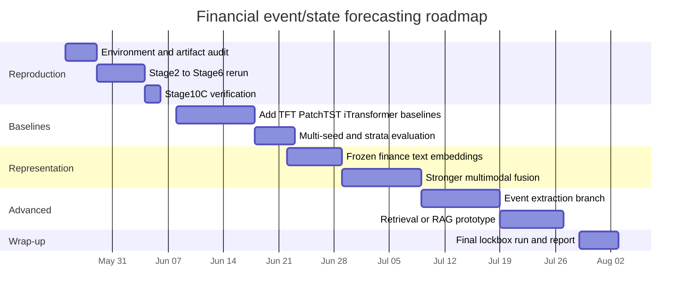

# Deep Research Report on ValdiviaEng Financial Event State Forecasting

## Executive summary

The `ValdiviaEng/financial-event-state-forecasting` repository is best understood as a **carefully governed, stagewise research benchmark harness** for testing whether firm-news “event-state” features improve **end-of-day, multi-horizon forward excess-return forecasting** beyond market-only baselines. Its approved phase-one benchmark is narrow by design: a reproducible top-50 large-cap universe, five horizons (`1d`, `5d`, `10d`, `20d`, `60d`), Alpha Vantage news, Twelve Data OHLCV, same-day-as-of-close news alignment, purged-plus-embargoed walk-forward validation, and a final untouched lockbox. The repository already materializes Stage 2 through Stage 6 benchmark artifacts, plus Stage 7 contextual-bandit diagnostics and Stage 10C historical prediction-output packets. fileciteturn52file0

The strongest repository-level finding is not a positive alpha claim. Stage 6 reports a **`clean_null`** result: the event-state gated-fusion model failed to improve on both predeclared primary losses versus the selected market-only hurdle on any of the primary horizons (`1d`, `5d`, `10d`) in validation or lockbox. The benchmark packet passed structurally, but comparability remains **`limitation_bearing`** because provider-level Alpha Vantage completeness is not claimed, the active split-adjustment method is still unresolved, and train-vs-validation gap analysis is blocked because Stage 5 saved only out-of-sample predictions. In other words, the repository’s current conclusion is scientifically conservative and internally consistent. fileciteturn16file0turn48file0turn22file0

Methodologically, the repository’s biggest strengths are **evaluation discipline and artifact reproducibility** rather than model sophistication. Relative to the last five years of research, its event representation is intentionally simple: mean-pooled **8-dimensional deterministic hash embeddings** of title/summary/URL plus a handful of scalar enrichments and no-news/provider flags. Its model ladder is also intentionally modest: seven market-only baselines plus one event-state gated-fusion regressor built from ridge branch models and a ridge combiner. This is a valid baseline research design, but it is far from current best practice in multimodal finance, event extraction, and time-series forecasting. Recent work is moving toward stronger sequence backbones such as TFT, PatchTST, and iTransformer; time-series foundation models such as Chronos, Moirai, and decoder-only pretrained forecasters; and finance-specific text models and retrieval pipelines such as BloombergGPT-, FinGPT-, and RAG-style systems. At the same time, recent benchmark work also warns that LLMs and complex event extractors often underperform under rigorous, standardized evaluation or fail to justify their added complexity. fileciteturn23file0turn26file0turn27file0turn21file0turn40file0turn41file0 citeturn0academia0turn13academia0turn18academia0turn11academia0turn11academia2turn20academia1turn7academia0turn7academia2turn8academia3turn10academia2

My bottom-line assessment is that this repository is already a **strong experimental control system** and a **weak forecasting model stack**. That combination is actually valuable. It means the next step should not be looser experimentation; it should be **upgrading the representation and model families while preserving the repository’s leakage-aware evaluation contract**. The most promising priorities are: replacing hash embeddings with finance-adapted text encoders, adding sequence-aware market baselines, introducing stronger multimodal fusion, expanding the comparator ladder to modern tabular/temporal architectures, and improving evaluation with train-prediction diagnostics, ablations, and statistical testing. fileciteturn16file0turn45file0turn54file0 citeturn9academia0turn9academia2turn19academia0turn10academia2turn8academia3

## Repository analysis

### What the repository contains

The root-level documentation describes the project as an “active-root rebuild” with Stage 6 serious benchmark reporting complete, Stage 7C contextual-bandit diagnostics materialized, Stage 8 update scripts implemented, and Stage 10C historical prediction-output packet generation complete. The current root is documentation-heavy and explicitly governed by `AgentRules.md`, `ScopeDecisionLog.md`, and `ResearchTruth.md`, while the active code lives under `src/event_state_forecasting/`, with active configs, tests, scripts, and materialized data artifacts under `data/`. The guidebook additionally states that some provider, utility, and expansion layers remain comment-only scaffolds rather than executable modules. fileciteturn52file0turn17file0turn15file0

A practical way to read the repository is as a staged pipeline:

| Stage | Main purpose | Key outputs | Current evidenced status |
|---|---|---|---|
| Stage 2 | Materialize benchmark panel | Partitioned Parquet panel, dataset manifest, row digest, clean-window record | Complete |
| Stage 3 | Build market features, event-state features, labels, aligned news | `market_features.parquet`, `event_state_features.parquet`, `labels.parquet`, `aligned_news.parquet` | Complete |
| Stage 4 | Build purged/embargoed splits and lockbox | split manifest, fold definitions, split assignments, leakage validation | Complete |
| Stage 5 | Train models and save OOS predictions | saved predictions, preprocessing manifests, model-fit manifests | Complete |
| Stage 6 | Evaluate, rank, compare, classify result | metrics, ranking diagnostics, paired comparisons, overfitting report, comparison summary | Complete |
| Stage 7C | Contextual-bandit diagnostics on post-lockbox holdout | diagnostic artifacts only | Complete, diagnostics-only |
| Stage 10C | Historical prediction-output packet generation | CSV/Parquet outputs and static HTML report | Complete, historical only |

Sources for the table: fileciteturn52file0turn17file0turn16file0

The repository’s local runbook is explicit that there is **no single approved end-to-end command**; instead, the system is intended to be run stage by stage through CLIs and validators. The usage documentation also emphasizes that the project is **local CLI/artifact-driven research only**, not a deployed service, inference API, dashboard, or trading product. fileciteturn17file0turn52file0turn55file0

### Data sources, formats, and preprocessing

The approved benchmark shape is straightforward: OHLCV comes from **Twelve Data**, news comes from **Alpha Vantage `NEWS_SENTIMENT`**, and SEC data is retained only for static/company support outside phase one. Alpha Vantage’s own documentation confirms that `NEWS_SENTIMENT` supports ticker/topic/time filtering and returns up to **1,000** matching results when `limit=1000`, with a default of 50. That limit matters directly to this repository because its docs record complete canonical raw file coverage at **850/850** ticker-year/current windows while also preserving explicit truncation-risk flags rather than claiming provider-level completeness. The guidebook records **92 likely truncated windows** and **10 empty-feed windows** in the top-50 corpus. fileciteturn52file0turn17file0 citeturn4view0turn4view2

Stage 2 builds a manifest-backed benchmark panel from the approved top-50 universe plus SPY support. The panel builder loads one full-window Twelve Data file per ticker, intersects common trading dates across the top-50 plus SPY, selects a clean window, checks that all approved forward horizons have valid endpoints, and injects year-level news availability flags from canonical Alpha Vantage files into each row. It also applies a very narrow derived cleaning rule for a documented CVX OHLC anomaly without mutating raw provider files. The Stage 2 artifact documented in the README contains **117,750 rows**, **471 as-of dates**, **50 tickers**, and **23,550 rows per horizon**. fileciteturn38file0turn39file0turn52file0

Stage 3 keeps preprocessing intentionally simple and contract-driven. Market features are same-row as-of-close values only: open, high, low, close, volume, intraday return, and intraday range ratio. News alignment follows a same-day-as-of-close rule in `America/New_York`: articles published on a trading day at or before 16:00 are assigned to that same trading date; after-close and non-trading-day articles roll forward to the next trading date. Event-state features are then built by grouping aligned articles per `(ticker, as_of_date)`, hashing each article’s `title + summary + url` into an **8-dimensional deterministic embedding** via SHA-256, mean-pooling those vectors, and attaching scalar enrichments such as aligned news count, minutes since latest aligned article, provider empty/truncation flags, and explicit no-news / empty-event-state indicators. fileciteturn23file0turn26file0turn27file0turn29file0turn30file0turn32file0

The label family is **forward excess returns**, not raw returns or price levels. For each row and horizon, Stage 3 computes the stock’s simple forward return and subtracts a **leave-one-out equal-weight return over the approved universe**. The labels config fixes the horizon set to `1d`, `5d`, `10d`, `20d`, and `60d`. Stage 3 documentation reports **67,840 aligned news records** and **71,420 no-news rows**, which means a large share of the benchmark operates under sparse-news conditions. That is an important design fact: the repository is not just a “news-rich” benchmark; it is also a benchmark about how to behave when there is no aligned news. fileciteturn24file0turn34file0turn52file0

### Model architectures, training procedures, evaluation, and results

The Stage 5 comparator ladder is intentionally modest. The frozen roster contains eight models: two constants (`market_zero_excess_return`, `market_train_mean`), ridge, elastic net, random forest, histogram gradient boosting, MLP, and one event-state model (`event_state_gated_fusion`). The modeling policy is **tiny fixed no hyperparameter search**, seed `1729`, and model-specific train-only preprocessing via median imputation and optional standard scaling. Hyperparameters are all fixed and conservative, for example ridge `alpha=1.0`, elastic net `alpha=1e-4, l1_ratio=0.15`, random forest `32` trees of max depth `6`, hist-gradient boosting with `60` iterations, and an MLP with a single hidden layer of size `16`. fileciteturn21file0turn41file0turn44file0turn45file0

The event-state model is not a deep multimodal network in the modern sense. It fits one ridge branch on market features, one ridge branch on event-state features, and then fits a third ridge “combiner” on branch predictions plus selected gate features and simple interactions. This makes it fast, deterministic, and easy to audit, but it is much closer to a stacked linear combiner than to a transformer, temporal encoder, graph model, or retrieval-augmented multimodal system. Training is strictly fold-local: preprocessors are fitted on train rows only, and Stage 5 intentionally writes only validation and lockbox predictions, not train predictions. The README reports **8 model IDs**, **360 model-fit records**, **360 preprocessing-fit records**, and **2,088,000 saved prediction rows**. fileciteturn40file0turn42file0turn43file0turn52file0

Stage 4 and Stage 6 are where the repository is strongest. Splits are monthly expanding walk-forward folds with a final untouched lockbox, using a **60-trading-day purge/embargo** derived from the maximum approved horizon. Stage 4 documentation reports **9 monthly development folds** and a final lockbox running from **2025-09-30 through 2026-02-13**. Stage 6 then evaluates with primary regression metrics—RMSE, MAE, out-of-sample `R²`, and predeclared mean loss differences versus a selected market hurdle—and mandatory secondary ranking diagnostics—Spearman rank IC, Kendall rank correlation, directional hit rate, and top-minus-bottom spread. The hurdle rule is strict: select the best market-only model per horizon by validation RMSE, then MAE. fileciteturn25file0turn22file0turn46file0turn47file0turn52file0

The published Stage 6 result is negative but informative. The selected market hurdles were `market_elastic_net` for `1d`, `10d`, `20d`, and `60d`, and `market_ridge` for `5d`. The event-state gated-fusion model did **not** improve on both primary loss deltas for any primary horizon in validation or lockbox, so the result class is `clean_null`. The serious packet passed, but comparability is tagged `limitation_bearing`, and the diagnostic status is `complete_with_explicit_train_gap_blocker` because Stage 5 deliberately saved no train predictions. The repository also explicitly refuses to convert these results into claims about trading profitability, direct sentiment-string ablations, or provider-level article completeness. This is a meaningful strength: the benchmark is willing to report a disciplined null result rather than inflate a weak edge. fileciteturn16file0turn48file0

### Code quality, reproducibility, and deployment posture

On code quality, the repository scores highly on **structure and scientific discipline**, and only moderately on **engineering maturity**. Positive signals include: deterministic seeds, clear CLI boundaries, machine-readable manifests, explicit validator scripts, fold-local preprocessing, row-universe digests, saved out-of-sample predictions, and strong protections against post hoc benchmark reinterpretation. The usage manual also records a validated command set and a cumulative test snapshot showing successful `py_compile` checks and **58 passed tests** across the active Stage 2–Stage 10C suite. fileciteturn42file0turn43file0turn45file0turn11file0

The main weaknesses are also clear. First, the repository still contains **comment-only scaffold areas**, especially in provider/utility/expansion layers, and at least one integration test file is explicitly a **COMMENT-ONLY TEST SCAFFOLD** rather than a real integration test. Second, the active docs I inspected do not surface a pinned package manifest or lockfile, so environment reproducibility is weaker than artifact reproducibility. Third, the code defaults are path-heavy and assume the documented local artifact layout is already present. Fourth, the active event representation is still a placeholder-quality baseline rather than a serious document encoder. These are not fatal flaws, but they are the difference between a good benchmark harness and a production-quality research platform. fileciteturn17file0turn54file0turn26file0turn52file0

Deployment is intentionally limited. The active scope is not a service or live inference system. Stage 10C generates local CSV/Parquet outputs and a static `report.html` from existing Stage 5 saved predictions. The implementation itself marks rows as `historical_prediction`, not fresh forecasts, and sets flags such as `not_trading_advice=True`, `service_api_scope=False`, and `forecast_candidate_approved=False`. So the repository does support a useful **offline reporting layer**, but not a deployable inference endpoint, streaming pipeline, or advice engine. fileciteturn55file0turn52file0

## Comparison with recent research

### Where the repository is behind current practice

The repository’s current event representation is several generations behind modern multimodal finance and modern event extraction. A deterministic hash of `title + summary + url` is fast and private, but it throws away syntax, discourse, cross-document redundancy, entity linking, event arguments, and temporal semantics. By contrast, recent financial-language work emphasizes domain-adapted parameterizations and richer contextualization. BloombergGPT shows that large-scale, finance-specialized pretraining can materially improve financial NLP performance without destroying general capability, while FinGPT pushes an open, data-centric pipeline for continuously updated financial LLMs and market-feedback-driven fine-tuning. Finance-focused forecasting work is also moving toward more structured contextual use of text, such as dissemination-aware prompting and RAG-style retrieval over historically relevant sequences. fileciteturn26file0turn27file0 citeturn7academia0turn7academia2turn19academia0turn8academia0

On the time-series side, the repository is also well behind current model families. It does not use sequence backbones over market history, does not learn temporal patterns across lookback windows, and does not exploit cross-sectional graph structure. Since 2021, strong generic forecasting families have included TFT for multi-horizon forecasting with variable selection and interpretable attention, PatchTST for patch-based long-horizon forecasting, iTransformer for variate-centric multivariate modeling, and pretrained foundation-model approaches such as Chronos, decoder-only universal forecasting models, and Moirai. Relative to those families, the repository’s current market branch is still mostly a **same-row tabular regression problem**, not a learned temporal forecasting problem. fileciteturn32file0turn40file0 citeturn0academia0turn13academia0turn18academia0turn11academia0turn11academia2turn20academia1

The repository also does not perform real event extraction. In modern NLP, end-to-end event extraction has moved toward structured generation and benchmark standardization. Text2Event and DEGREE both recast event extraction as generation, and TextEE shows that when evaluation is standardized and reproducible, the gap between claimed and real performance can be substantial—and that LLMs still struggle on rigorous event extraction benchmarks. In finance-specific information extraction, KPI-EDGAR adds a domain benchmark for relation extraction from financial documents, and EFSA argues for event-level financial sentiment rather than coarse article-level sentiment alone. Compared with those directions, this repository currently uses “event-state” in a much looser sense: aggregated article embeddings plus flags, not extracted events or event tuples. citeturn10academia0turn10academia1turn10academia2turn16academia2turn16academia3

### Where the repository is stronger than much of the literature

Despite those modeling gaps, the repository is unusually strong on **scientific controls**. Many finance papers still rely on weaker chronological splits, thin baselines, or post hoc metric narratives. Here, the project freezes a benchmark family, uses purged-plus-embargoed walk-forward development, preserves a final untouched lockbox, saves out-of-sample predictions, predeclares result-class logic, and explicitly blocks unsupported claims. That rigor is closer in spirit to benchmark-correction efforts like TextEE and to recent critiques showing that more model complexity does not automatically produce more trustworthy forecasting results. The repository’s null result is therefore more credible than many small positive claims in the literature. fileciteturn16file0turn22file0turn25file0turn45file0turn48file0 citeturn10academia2turn18academia1turn8academia3

### Comparative tables

| Model or family | Representative source | What it does better than the repo | What the repo still does better |
|---|---|---|---|
| Current repo gated fusion | Repo code | Simple, auditable, deterministic, cheap | Stronger evaluation discipline than many papers |
| TFT | Lim et al. | Multi-horizon sequence modeling with variable selection and interpretability | Repo has stricter leakage controls already wired into artifacts |
| PatchTST | Nie et al. | Strong temporal backbone for long-horizon forecasting | Repo currently easier to reproduce on CPU |
| iTransformer | Liu et al. | Better multivariate correlation modeling across variables | Repo has explicit market hurdle comparisons |
| Chronos / decoder-only universal TS models / Moirai | Ansari et al.; Das et al.; Woo et al. | Zero-shot or transfer-ready forecasting priors from large corpora | Repo currently easier to audit at row level |
| BloombergGPT / FinGPT | Wu et al.; Liu et al. | Finance-specialized language understanding | Repo’s text path is far cheaper and privacy-friendlier |
| MSGCA / CausalStock / RAG-style finance methods | Zong & Zhou; Li et al.; Xiao et al. | Stronger multimodal and cross-asset reasoning | Repo’s benchmark integrity is stronger than many research prototypes |

Sources for the table: fileciteturn40file0turn48file0 citeturn0academia0turn13academia0turn18academia0turn11academia0turn11academia2turn20academia1turn7academia0turn7academia2turn9academia0turn9academia2turn8academia0

| Dataset or benchmark | Modalities | Scale | Relevance to this repo |
|---|---|---|---|
| Repo phase-one benchmark | OHLCV + aligned news + scalar event-state flags | 50 tickers, 471 as-of dates, 117,750 rows | Narrow, leakage-aware benchmark for controlled comparison |
| FinMultiTime | News + tables + charts + price series | 5,105 stocks, 2009–2025, 112.6 GB | Shows how much larger a modern multimodal finance dataset can be |
| KPI-EDGAR | Financial documents for relation extraction | Financial-report extraction benchmark | Relevant if adding structured financial IE |
| EFSA | Event-level financial sentiment | 12,160 articles, 13,725 quintuples | Relevant if replacing article-level proxies with event-level supervision |
| TextEE | Standardized event extraction benchmark | 16 datasets, 14 methods reevaluated | Relevant for robust EE methodology and reproducibility |

Sources for the table: fileciteturn52file0 citeturn17academia0turn16academia2turn16academia3turn10academia2

| Metric family | Used in repo now | Interpretation | My recommendation |
|---|---|---|---|
| RMSE, MAE | Yes | Primary regression losses | Keep |
| `R²_oos` vs zero baseline | Yes | Scale-aware relative fit | Keep |
| Mean loss deltas vs best market hurdle | Yes | Direct benchmark improvement test | Keep |
| Spearman IC, Kendall, directional hit, top-bottom spread | Yes | Secondary ranking diagnostics | Keep |
| P-values / multiple-comparison-adjusted inference | No | Statistical strength of effect | Add |
| Train-vs-validation generalization gap | Blocked | Overfitting diagnosis | Add by saving train predictions |
| Probabilistic calibration / quantile losses | No | Uncertainty quality | Add in later phase |
| Cost-aware portfolio metrics | No, explicitly out of scope | Deployment relevance | Keep out of phase one |

Sources for the table: fileciteturn22file0turn46file0turn47file0turn48file0turn16file0

### Concrete improvement suggestions

The highest-value **data improvement** is to keep the current benchmark contract but improve the text signal. Concretely, replace the Stage 3 hash embedding with a finance-adapted encoder stack: first a frozen domain encoder baseline such as FinBERT/BloombergGPT-style embeddings or a lighter open financial encoder; then a temporal article aggregation module; then a clean ablation versus the existing hash baseline. This should raise representational quality without immediately exploding experimental complexity. A second data improvement is to move from article-level pooling toward **event-level representations**—even a modest extraction of event type, affected entity, polarity, and timestamps would be a real upgrade. Finally, preserve the repository’s current provider flags, because news missingness and truncation are likely predictive nuisance variables rather than just quality-control metadata. fileciteturn23file0turn26file0turn27file0 citeturn7academia0turn7academia2turn16academia3turn10academia2

The highest-value **model improvement** is to strengthen the comparator ladder before jumping to heavyweight LLM pipelines. Add sequence-aware market-only baselines such as TFT, PatchTST, and iTransformer; then add a stronger multimodal model, for example a two-branch temporal encoder where market history and article/event sequences interact through cross-attention or late fusion. If those stronger baselines already beat the current ridge/elastic/forest/MLP hurdle set, then comparing a stronger multimodal model becomes more meaningful. Only after that should the project consider RAG-style historical retrieval, graph-based cross-asset models, or LLM-driven reasoning layers. fileciteturn21file0turn41file0turn40file0 citeturn0academia0turn13academia0turn18academia0turn9academia0turn9academia2turn8academia0

The highest-value **evaluation improvement** is to maintain the existing benchmark integrity while closing the current blind spots. Save train predictions so the train-validation gap can be computed; add paired-significance or bootstrap uncertainty for the loss deltas; report ablations over no-news rows versus news rows; report performance under provider truncation-risk strata; and add stability checks over multiple seeds for the nonconvex baselines. The repository is already structurally ready for this style of evaluation, so the marginal work is much lower than building a new benchmark from scratch. fileciteturn16file0turn48file0turn45file0

## Reproduction plan

### What is required

Because the repository is private and because the prompt assumes no unspecified credentials are available, the realistic reproduction target is **offline rerunning of the documented historical pipeline** rather than live provider refresh. If the private clone includes the documented `data/raw/`, `data/datasets/`, `data/features/`, `data/splits/`, and `data/models/` roots, then Stages 2–6 and Stage 10C are reproducible without fresh Alpha Vantage or Twelve Data calls. If those directories are missing, you can still reproduce the code path and validators, but not the full benchmark artifacts. Stage 8 live updates and any missing raw data remain blocked without API keys and quota-approved execution. fileciteturn52file0turn17file0

A practical environment should include Python 3.10+ and, conservatively, Python 3.11. The minimal dependency set inferable from the active code is: `numpy`, `pandas`, `pyarrow`, `scikit-learn`, `PyYAML`, and `pytest`. This list is inferred from imports and file I/O in the active code paths, not from a repository-provided lockfile. fileciteturn38file0turn42file0turn44file0turn45file0

### Environment bootstrap

```bash
git clone <private-repo-url>
cd financial-event-state-forecasting

python -m venv .venv
source .venv/bin/activate

pip install numpy pandas pyarrow scikit-learn pyyaml pytest

export PYTHONPATH=src
```

The repository’s own command examples are written mostly in PowerShell with `PYTHONPATH=src`; the shell block above is the POSIX equivalent. fileciteturn52file0turn42file0

### Step-by-step rerun

Start with structural validation and stop immediately if required raw or stage artifacts are missing.

```bash
python scripts/validate_agent_governance.py
python scripts/validate_stage0_stage1_completion.py
python scripts/validate_stage2_inputs.py
```

Then rebuild progressively:

```bash
python -m event_state_forecasting.cli.build_benchmark_dataset
python scripts/validate_stage2_completion.py

python scripts/validate_stage3_readiness.py
python -m event_state_forecasting.cli.build_features_and_labels
python scripts/validate_stage3_completion.py

python -m event_state_forecasting.cli.build_splits_and_packet
python scripts/validate_stage4_completion.py

python -m event_state_forecasting.cli.train_models_and_predict
python scripts/validate_stage5_completion.py

python -m event_state_forecasting.cli.run_benchmark
python scripts/validate_stage6_completion.py
```

If you want the historical reporting layer:

```bash
python -m event_state_forecasting.cli.generate_prediction_outputs \
  --run-date 2026-05-23 \
  --allow-overwrite \
  --json
```

And then validate the packet with the emitted output root. The command pattern above is taken directly from the repository’s safe-command list. fileciteturn52file0

### Hyperparameters and success criteria

The key frozen hyperparameters are already encoded in the YAML/JSON configs and should not be changed during first reproduction:

- Horizons: `1d`, `5d`, `10d`, `20d`, `60d`.
- Split protocol: monthly expanding folds, 60-day purge/embargo, final 20% lockbox.
- Model seed: `1729`.
- Search policy: `tiny_fixed_no_hyperparameter_search`.
- Event-state embedding dimension: `8`, pooling policy `mean`.
- Comparator ladder: 8 model IDs exactly as frozen in `configs/models.yaml`.
- Evaluation event-state model: `event_state_gated_fusion`; market hurdle chosen per horizon from market-only models by validation RMSE then MAE. fileciteturn23file0turn24file0turn25file0turn21file0turn22file0

A successful reproduction should recover approximately the following milestone checks:

| Milestone | Expected evidence |
|---|---|
| Stage 2 | 117,750 rows; 471 as-of dates; 50 tickers |
| Stage 3 | 117,750 feature/label rows; 67,840 aligned news records; 71,420 no-news rows |
| Stage 4 | 9 development folds; lockbox 2025-09-30 to 2026-02-13 |
| Stage 5 | 8 models; 360 model fits; 360 preprocessing fits; 2,088,000 saved prediction rows |
| Stage 6 | 800 metric rows; 800 ranking rows; 800 paired-comparison rows; result `clean_null` |
| Stage 10C | 250 model-output rows; 50 primary top-10 rows; static HTML report |

Sources for the table: fileciteturn52file0turn16file0

### Reproduction compute and time budget

These are **engineering estimates**, not repository-declared benchmarks. They are based on the documented sample sizes, fold counts, and model roster.

| Task | Suggested hardware | Estimated wall time | Notes |
|---|---|---:|---|
| Validators only | 4 CPU cores, 8 GB RAM | 5–15 min | Fastest first-pass sanity check |
| Stage 2 rebuild | 4–8 CPU cores, 8–16 GB RAM | 10–30 min | Mostly JSON/parquet I/O and panel construction |
| Stage 3 rebuild | 4–8 CPU cores, 8–16 GB RAM | 20–45 min | Loads raw news JSON, aligns dates, builds features/labels |
| Stage 4 rebuild | 2–4 CPU cores, 8 GB RAM | 5–15 min | Split bookkeeping is light |
| Stage 5 rerun | 4–8 CPU cores, 16 GB RAM | 30–90 min | 360 fixed model fits; CPU is sufficient |
| Stage 6 rerun | 2–4 CPU cores, 8 GB RAM | 5–15 min | Pure evaluation over saved predictions |
| Stage 10C packet | 2–4 CPU cores, 8 GB RAM | 2–10 min | Reporting only |

Sources for the table: fileciteturn52file0turn21file0turn42file0turn16file0

## Experimental roadmap

### Prioritized experiments

The right roadmap is to **preserve the benchmark contract and progressively strengthen representation and baselines**. The ordering below is deliberate: first make sure the current repository reruns cleanly, then improve market-only temporal modeling, then improve text representation, then move to stronger multimodal fusion, and only after that test higher-cost LLM/RAG/event-extraction ideas.

| Priority | Experiment | Why first | Expected outcome | Success criterion |
|---|---|---|---|---|
| High | Reproduce current Stage 2–6 pipeline | Establish trust in local environment and artifact integrity | Same `clean_null` class or numerically near-identical artifacts | Validators pass; counts and result class match |
| High | Add stronger market-only temporal baselines (TFT, PatchTST, iTransformer) | The current market hurdle set is weak relative to recent TS practice | Stronger baseline floor; maybe lower losses even without news | One or more new market-only models beats current strict hurdle on validation and lockbox |
| High | Replace hash embeddings with finance-adapted text embeddings | Biggest representational bottleneck in current pipeline | Better event-state features without changing evaluation | Event-state model improves primary losses on at least one horizon without degrading lockbox stability |
| Medium | Add sequence-aware multimodal fusion | Current gated fusion is static and shallow | Better use of market history plus news/event timing | Beat strengthened market hurdle on at least one primary horizon in both validation and lockbox |
| Medium | Add news-rich vs news-sparse stratified evaluation | Large no-news fraction may be masking conditional gains | Clearer picture of when news helps | Significant gain in news-rich subset without harming no-news stability |
| Medium | Save train predictions and add statistical inference | Current overfitting analysis is incomplete | Better diagnostic credibility | Train-gap section unblocked; bootstrap or paired-significance summaries added |
| Lower | Add event extraction branch | Higher complexity and data dependence | More interpretable, structured event features | Event-level branch beats article-level embedding branch on at least one primary horizon |
| Lower | Test retrieval/RAG or contextual-bandit promotion only after stronger supervised wins | Highest complexity and highest risk of benchmark drift | Better long-context reasoning or action selection | Must beat upgraded supervised baseline and remain leakage-safe |

Sources for the table: fileciteturn16file0turn22file0turn48file0turn52file0 citeturn0academia0turn13academia0turn18academia0turn9academia0turn9academia2turn8academia0turn10academia2

### Estimated budget for proposed experiments

| Experiment bucket | Hardware | Estimated budget |
|---|---|---|
| Stronger market-only baselines | 1 workstation, 8 CPU cores or 1 small GPU | 1–2 days |
| Finance-adapted frozen text embeddings + linear/gated fusion | 1 × 24 GB GPU | 1–2 days |
| Temporal multimodal fusion model | 1 × 24–48 GB GPU | 2–4 days |
| Event extraction branch with structured features | 1 × 24–48 GB GPU + annotation/label engineering time | 3–7 days |
| RAG / LLM-enhanced forecasting prototype | 1–2 × 24–80 GB GPUs plus vector DB infrastructure | 4–10 days |

These are again estimates. They are grounded in the repository’s relatively small benchmark size and in the substantially larger architectural cost of the newer model families. fileciteturn52file0turn21file0 citeturn7academia0turn7academia2turn11academia0turn20academia1

### Suggested timeline



## Risks, budgets, and referenced files

### Risk and ethical considerations

The repository already handles the most common financial-ML failure mode—**data leakage**—better than average, through purging, embargoing, final lockbox isolation, fold-local preprocessing, and saved out-of-sample predictions. But there are still important risks. The train-vs-validation gap remains uncomputed because train predictions were never saved, so some overfitting modes remain invisible. That is why the current comparability label is not fully “comparable.” fileciteturn25file0turn45file0turn16file0turn48file0

There is also clear **data-bias risk**. The benchmark universe is an approved top-50 liquid large-cap set, which is useful for controlled experiments but necessarily biases the task toward large-cap, high-liquidity, high-coverage names. In addition, Alpha Vantage completeness is explicitly not claimed, and truncation-risk or empty-feed windows are preserved as limitations rather than repaired away. That means any learned “news effect” is partly confounded by provider coverage and ticker-level news density. fileciteturn52file0turn17file0 citeturn4view0turn4view2

A third risk is **market-impact overinterpretation**. The repository explicitly says the Stage 6 result is not a trading-profitability claim, and Stage 10C outputs are historical prediction packets rather than live forecasts or trading advice. That boundary should be preserved. It would be an error to translate current artifacts into a production ranking system, much less an autonomous buy/sell signal, without a separate execution-cost-aware, turnover-aware, and compliance-aware program of work. fileciteturn16file0turn55file0turn52file0

Finally, there is a **security/privacy** issue in the raw-data operations layer: the guidebook and README explicitly warn that Alpha Vantage and Twelve Data ledgers or daemon logs may contain API-key-bearing URLs and must not be committed or shared without sanitization. That matters for any reproduction or collaboration workflow. fileciteturn17file0turn52file0

### Open questions and limitations

A few items remain incomplete from this inspection. I did not inspect every materialized metric row in the Stage 6 output tables, so this report focuses on the high-confidence artifact-level result class and benchmark logic rather than reproducing every per-horizon metric value. I also did not find an active pinned environment file in the inspected active-root docs, so the environment recipe above is inferred from code imports. Finally, because repository access is private and provider credentials are assumed unavailable, practical reproducibility still depends on whether the documented raw and intermediate artifact trees are actually present in the user’s clone. fileciteturn16file0turn17file0turn42file0turn45file0

### Referenced repository file URLs

Below are the key repository files referenced in this report. Because the repository is private, these URLs assume the viewer has access.

```text
https://github.com/ValdiviaEng/financial-event-state-forecasting/blob/main/README.md
https://github.com/ValdiviaEng/financial-event-state-forecasting/blob/main/ResearchTruth.md
https://github.com/ValdiviaEng/financial-event-state-forecasting/blob/main/UsageManual.md
https://github.com/ValdiviaEng/financial-event-state-forecasting/blob/main/Complete_guidebook.txt
https://github.com/ValdiviaEng/financial-event-state-forecasting/blob/main/configs/features.yaml
https://github.com/ValdiviaEng/financial-event-state-forecasting/blob/main/configs/labels.yaml
https://github.com/ValdiviaEng/financial-event-state-forecasting/blob/main/configs/splits.yaml
https://github.com/ValdiviaEng/financial-event-state-forecasting/blob/main/configs/models.yaml
https://github.com/ValdiviaEng/financial-event-state-forecasting/blob/main/configs/evaluation.yaml
https://github.com/ValdiviaEng/financial-event-state-forecasting/blob/main/configs/stage7_contextual_bandit.yaml
https://github.com/ValdiviaEng/financial-event-state-forecasting/blob/main/src/event_state_forecasting/dataset/panel_builder.py
https://github.com/ValdiviaEng/financial-event-state-forecasting/blob/main/src/event_state_forecasting/cli/build_benchmark_dataset.py
https://github.com/ValdiviaEng/financial-event-state-forecasting/blob/main/src/event_state_forecasting/cli/build_features_and_labels.py
https://github.com/ValdiviaEng/financial-event-state-forecasting/blob/main/src/event_state_forecasting/cli/train_models_and_predict.py
https://github.com/ValdiviaEng/financial-event-state-forecasting/blob/main/src/event_state_forecasting/features/market.py
https://github.com/ValdiviaEng/financial-event-state-forecasting/blob/main/src/event_state_forecasting/features/news_alignment.py
https://github.com/ValdiviaEng/financial-event-state-forecasting/blob/main/src/event_state_forecasting/features/embeddings.py
https://github.com/ValdiviaEng/financial-event-state-forecasting/blob/main/src/event_state_forecasting/features/event_state.py
https://github.com/ValdiviaEng/financial-event-state-forecasting/blob/main/src/event_state_forecasting/features/labels.py
https://github.com/ValdiviaEng/financial-event-state-forecasting/blob/main/src/event_state_forecasting/models/market_baselines.py
https://github.com/ValdiviaEng/financial-event-state-forecasting/blob/main/src/event_state_forecasting/models/gated_fusion.py
https://github.com/ValdiviaEng/financial-event-state-forecasting/blob/main/src/event_state_forecasting/models/comparator_ladder.py
https://github.com/ValdiviaEng/financial-event-state-forecasting/blob/main/src/event_state_forecasting/models/training.py
https://github.com/ValdiviaEng/financial-event-state-forecasting/blob/main/src/event_state_forecasting/evaluation/regression.py
https://github.com/ValdiviaEng/financial-event-state-forecasting/blob/main/src/event_state_forecasting/evaluation/ranking.py
https://github.com/ValdiviaEng/financial-event-state-forecasting/blob/main/src/event_state_forecasting/evaluation/comparison_summary.py
https://github.com/ValdiviaEng/financial-event-state-forecasting/blob/main/src/event_state_forecasting/stage10/prediction_outputs.py
https://github.com/ValdiviaEng/financial-event-state-forecasting/blob/main/tests/models/test_gated_fusion_contract.py
https://github.com/ValdiviaEng/financial-event-state-forecasting/blob/main/tests/integration/test_pipeline_contract.py
https://github.com/ValdiviaEng/financial-event-state-forecasting/blob/main/docs/agent/agent_log/Stage6_Serious_Benchmark_Reporting_2026-05-21.md
```

Referenced URL list derived from the inspected repository files. fileciteturn52file0turn17file0turn16file0turn55file0
