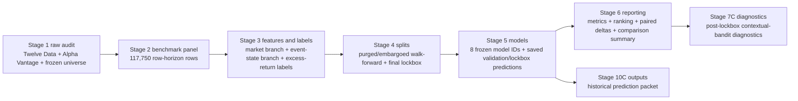
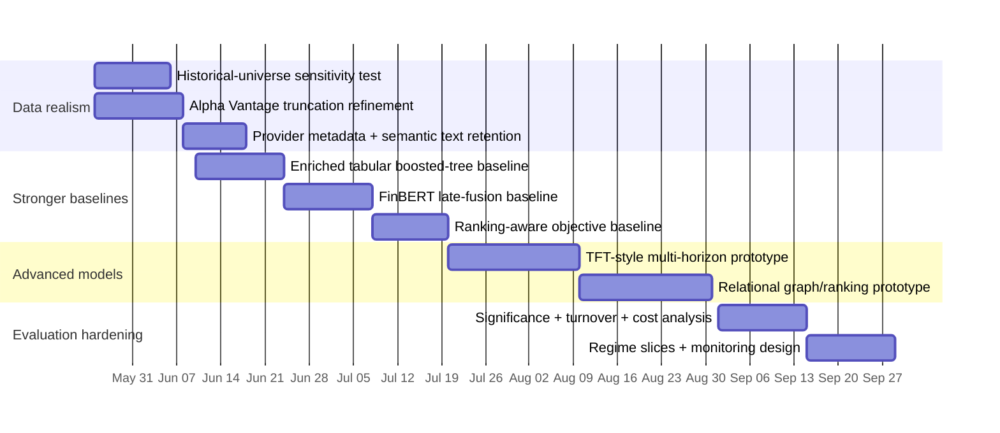

# Deep Research Report on ValdiviaEng Financial Event State Forecasting

## Executive summary

The repository `ValdiviaEng/financial-event-state-forecasting` is best understood as a **governance-first, stage-gated research benchmark** for testing whether aligned firm-news “event-state” features add value beyond market-only baselines for **multi-horizon forward excess-return forecasting**. Its strongest contribution is not model novelty; it is the disciplined pipeline around dataset versioning, row-universe digests, purged-and-embargoed walk-forward splits, a final untouched lockbox, train-only preprocessing, saved out-of-sample predictions, and explicit non-claims at each stage. The project documents a Stage 2 dataset with **117,750 row-horizon observations** over **50 equities** and **5 horizons**, a Stage 3 feature/label build with **67,840 aligned news records**, a Stage 4 split build with **9 folds** and a **final 20% lockbox**, a Stage 5 model materialization with **8 model IDs** and **2,088,000 saved predictions**, and a Stage 6 benchmark report whose current outcome is **`clean_null`** with **`limitation_bearing` comparability** rather than a positive benchmark claim. fileciteturn53file0L3-L3 fileciteturn54file0L3-L3 fileciteturn55file0L3-L3 fileciteturn51file0L3-L3 fileciteturn50file0L3-L3

Technically, the repository’s core event-state model is intentionally simple: a **two-branch ridge-based gated fusion regressor** that fits separate market and event-state ridge models and then a ridge combiner on branch predictions plus selected event-state gate features. Market features are restricted to same-row end-of-day OHLCV and two derived intraday statistics; event-state features are restricted to aligned-article counts, timing, no-news/provider flags, and an **8-dimensional deterministic hash embedding** mean-pooled across articles. Labels are **leave-one-out equal-weight approved-universe forward excess returns** over horizons `1d`, `5d`, `10d`, `20d`, and `60d`. This design is auditable and cheap to run, but it is materially less expressive than recent multimodal finance literature built around domain-specific language models, temporal attention, graph/relational structure, or broader multimodal datasets. fileciteturn21file0L3-L3 fileciteturn35file0L3-L3 fileciteturn30file0L3-L3 fileciteturn31file0L3-L3 fileciteturn34file0L3-L3 citeturn2academia0turn2academia3turn10academia0turn10academia1turn0academia1turn1academia2

My bottom-line assessment is that the repository is **excellent as a first serious benchmark scaffold** and **not yet competitive as a strong multimodal financial forecasting system**. Its biggest strengths are leakage discipline, artifact traceability, and honest result governance. Its biggest weaknesses are feature poverty, very weak text representation, the absence of stronger modern tabular and multimodal baselines, a lack of transaction-cost/statistical-significance evaluation, and a major design risk from using a **frozen 2026 top-50 universe** to evaluate earlier periods, which creates a plausible **survivorship/look-ahead universe bias**. The highest-priority next steps are therefore not “deploy this model,” but first to repair data realism and baseline strength: add historical-universe sensitivity tests, ingest richer textual/provider metadata, introduce boosted-tree and FinBERT-style late-fusion baselines, and then only after that move toward temporal/relational multimodal models and production monitoring. fileciteturn58file0L3-L3 fileciteturn59file0L3-L3 fileciteturn12file0L3-L3 fileciteturn15file0L3-L3 fileciteturn50file0L3-L3 citeturn2academia3turn10academia0turn10academia3turn0academia3

## Repository architecture and evidence trail

The repository documents itself as a **local CLI/artifact-driven research system** spanning Stage 0 through Stage 10C, with current active evidence for Stage 2 dataset materialization, Stage 3 features and labels, Stage 4 splits, Stage 5 model predictions, Stage 6 reporting, and Stage 7C post-lockbox diagnostics. Its README and usage documentation emphasize a **stagewise rebuild** rather than a single opaque pipeline command, and the architecture map explicitly distinguishes active executable modules from comment-only scaffolding. fileciteturn1file0L3-L3 fileciteturn2file0L3-L3 fileciteturn4file0L3-L3

At a high level, the code structure is clean and coherent. The `data` and `dataset` modules define universe, contracts, dataset manifests, digests, and panel construction. The `features` package handles market features, event-state alignment and embeddings, no-news state preservation, and labels. The `split` package creates purged/embargoed walk-forward folds and validates leakage. The `models` package defines the comparator ladder, baseline estimators, preprocessing, the gated-fusion regressor, and prediction schema validation. The `evaluation` package computes regression metrics, ranking diagnostics, paired loss deltas, overfitting diagnostics, comparison summaries, and comparability classification. The `cli` entry points then materialize each stage. fileciteturn4file0L3-L3 fileciteturn39file0L3-L3 fileciteturn37file0L3-L3 fileciteturn30file0L3-L3 fileciteturn41file0L3-L3 fileciteturn22file0L3-L3 fileciteturn43file0L3-L3

The repository’s actual evidence chain is unusually strong for a personal or small-team research repo. Each major stage has both executable code and a human-readable completion log recording the chosen decisions, artifact identities, counts, validation commands, and known limitations. This produces an auditable progression from raw-data audit to final reporting rather than a single result notebook. That is a meaningful engineering strength, especially in a domain where backtests are easy to contaminate. fileciteturn59file0L3-L3 fileciteturn53file0L3-L3 fileciteturn54file0L3-L3 fileciteturn55file0L3-L3 fileciteturn51file0L3-L3 fileciteturn50file0L3-L3

The following table is the most compact way to understand the repository’s executed artifacts and what each stage does.

| Stage | What is materialized | Key counts / identity | What it explicitly does **not** claim | Evidence |
|---|---|---:|---|---|
| Stage 2 | Benchmark panel dataset | 50 tickers, 471 as-of dates, 117,750 rows, clean window `2024-04-01` to `2026-02-13` | not features, not labels, not models, not metrics | fileciteturn53file0L3-L3 |
| Stage 3 | Market features, event-state features, labels, aligned news | 117,750 rows, 67,840 aligned news records, 46,330 rows with aligned news, 71,420 no-news rows | not splits, not predictions, not benchmark result | fileciteturn54file0L3-L3 |
| Stage 4 | Purged/embargoed folds, assignments, leakage validation, lockbox record | 9 folds, 1,059,750 assignment rows, lockbox `2025-09-30` to `2026-02-13` | not models, not metrics | fileciteturn55file0L3-L3 |
| Stage 5 | Saved predictions + preprocessing/model-fit manifests | 8 models, 360 fits, 2,088,000 saved prediction rows | not metrics, not model comparison, not result claim | fileciteturn51file0L3-L3 |
| Stage 6 | Metrics, ranking diagnostics, paired comparisons, summary | 800 metric rows, 800 ranking rows, 800 paired-comparison rows, result `clean_null` | not trading profitability, not positive result claim | fileciteturn50file0L3-L3 |
| Stage 7C | Diagnostics-only post-lockbox policy study | 22,750 context rows, 180,180 policy-selection rows, 4,620 metric rows | not Stage 6 reinterpretation, not live signals | fileciteturn57file0L3-L3 |

## Data pipeline and schemas

The repository’s data pipeline starts from three frozen upstream decisions: a **top-50 large-cap stock universe**, **Twelve Data** as the OHLCV provider, and **Alpha Vantage NEWS_SENTIMENT** as the news provider. The frozen universe file is `top50_slickcharts_2026-04-10.csv`; the code enforces exactly 50 tickers, excludes `SPY` from the stock universe rows, and preserves dot tickers such as `BRK.B`. The Stage 1 and Stage 2 logs confirm that `SPY` is used only as a support/reference ticker and not as a member of benchmark rows. fileciteturn58file0L3-L3 fileciteturn53file0L3-L3

That universe choice creates one of the report’s most important findings: because the universe is **selected from a 2026 snapshot** but used to build a benchmark panel whose clean window starts in **2024**, the benchmark is exposed to likely **survivorship and universe look-ahead bias**. This does not invalidate every experiment, but it does mean the current results are stronger as an internal fixed-universe benchmark than as a historically realistic investable simulation. This issue is not hidden by the code; it follows directly from the frozen universe path and date range. fileciteturn58file0L3-L3 fileciteturn53file0L3-L3

The raw-source situation is mixed. On the positive side, the repo documents complete canonical Alpha Vantage window coverage for the approved top-50 corpus and complete Twelve Data full-window files for the top-50 plus `SPY`, with no post-first-available-date gaps and only five late-start names in the OHLCV provider history. On the negative side, the Stage 1 audit found **92 likely truncated Alpha Vantage windows** and **10 empty-feed windows**, while Alpha Vantage’s own documentation confirms that `NEWS_SENTIMENT` returns at most **1,000 records** when `limit=1000` is used. The repository responsibly treats those windows as truncation-risk rather than completeness. That is exactly the right scientific posture. fileciteturn59file0L3-L3 fileciteturn60file0L3-L3 citeturn4view0turn4view1turn4view2

The Stage 2 panel schema is explicit. Its row key is `(benchmark_family_id, canonical_ticker, as_of_date, horizon_id)`, and required fields include metadata for prediction timestamp, feature availability timestamp, label window start/end, split-role placeholders, lockbox/purge/embargo flags, market availability, news-provider status, aligned-news count, no-news flags, provider truncation/empty-feed flags, and alignment status. This is not just good hygiene; it is what makes later split and leakage validation enforceable. fileciteturn39file0L3-L3 fileciteturn37file0L3-L3 fileciteturn38file0L3-L3

Stage 2 itself creates a panel with one row per `(ticker, as_of_date, horizon)` over the approved horizons `1d`, `5d`, `10d`, `20d`, and `60d`. The builder computes label windows from the common trading calendar, preserves no-news and provider-risk flags, and patches only a known CVX OHLC anomaly in **derived cleaned records** while leaving raw provider files untouched. That derived-only patch policy is another governance-positive choice. fileciteturn39file0L3-L3 fileciteturn37file0L3-L3 fileciteturn38file0L3-L3

Stage 3 then splits into three artifacts: market features, event-state features, and labels. Market features are intentionally sparse: `market_open`, `market_high`, `market_low`, `market_close`, `market_volume`, `market_intraday_return`, and `market_intraday_range_ratio`, all computed from the same row’s as-of-close values only. There are **no lagged returns, rolling volatility features, sector factors, benchmark-relative states, or cross-sectional standardized features** in the active market feature set. That choice keeps leakage risk low, but it is a major modeling limitation. fileciteturn12file0L3-L3 fileciteturn35file0L3-L3

The event-state branch is the repo’s distinctive component, but it is also where the biggest representational gap appears. Articles are aligned using a clear financial-time rule: same-day articles at or before the market close stay on that trading day; after-close or non-trading-day articles roll forward to the next trading day. For each row, the builder then creates summary statistics and an **8-dimensional deterministic hash embedding** mean-pooled over aligned articles from `title + summary + url`. It also preserves `stage3_aligned_news_count`, `minutes_since_latest_aligned_article`, `no_news_flag`, `empty_event_state_flag`, `provider_empty_feed_flag`, and `provider_truncation_risk_flag`. fileciteturn32file0L3-L3 fileciteturn30file0L3-L3 fileciteturn31file0L3-L3 fileciteturn33file0L3-L3

Two points matter here analytically. First, the repo correctly treats **no news as a state**, not as a dropped row; that is a strong design decision because absence of news is often informative in financial settings. Second, although the provider endpoint is explicitly a **news-and-sentiment API**, the normalization code only keeps `time_published`, `title`, `summary`, and `url` from each raw item before hashing, so the active pipeline is effectively **throwing away provider-native article metadata/sentiment fields**. In other words, the repo chose the hard problem of event-state forecasting, but the current event-state representation is closer to a compact placeholder than to a strong semantic event encoder. fileciteturn30file0L3-L3 citeturn4view0turn4view2

Labels are also carefully defined. Instead of predicting raw returns or direction, the Stage 3 label builder creates **forward simple return minus a leave-one-out equal-weight simple return of the other approved companies** in the universe. This is a reasonable relative-value target for a cross-sectional benchmark. It also means the problem is conceptually closer to **stock selection / cross-sectional ranking** than to pure single-series forecasting, even though the repo trains regression models first and treats ranking diagnostics as secondary. fileciteturn34file0L3-L3 fileciteturn44file0L3-L3 fileciteturn45file0L3-L3

The most useful schema summary is below.

| Artifact | Core schema / semantics | What is especially good | What is missing or risky | Evidence |
|---|---|---|---|---|
| Stage 2 `benchmark_panel` | row key + timing + provider/no-news status + OHLCV + split placeholders | explicit row contract, provider risk preserved | frozen 2026 universe applied to earlier history | fileciteturn39file0L3-L3 fileciteturn37file0L3-L3 fileciteturn58file0L3-L3 |
| Stage 3 `market_features` | same-row OHLCV + intraday return/range ratio | leakage-safe | no lags, no rolling risk/liquidity factors, no benchmark-relative states | fileciteturn12file0L3-L3 fileciteturn35file0L3-L3 |
| Stage 3 `event_state_features` | aligned-news count/timing/flags + 8 hash-embedding dims | keeps no-news state and provider flags | discards richer semantic/provider metadata; embedding is extremely weak | fileciteturn12file0L3-L3 fileciteturn30file0L3-L3 fileciteturn31file0L3-L3 |
| Stage 3 `labels` | leave-one-out equal-weight forward excess return | cross-sectional target is coherent | not directly tied to transaction-costed strategy evaluation | fileciteturn13file0L3-L3 fileciteturn34file0L3-L3 |

## Models, training, evaluation, and reproduced results

Stage 5 freezes a **comparator ladder of 8 models** with a `tiny_fixed_no_hyperparameter_search` policy and seed `1729`. The approved families are `constant_zero`, `constant_train_mean`, `ridge`, `elastic_net`, `random_forest`, `hist_gradient_boosting`, `mlp`, and `simple_gated_fusion`, with all market-only families restricted to market features and the gated-fusion family restricted to joint market-plus-event-state inputs. This is a reasonable baseline roster, but it is still a modest one by modern standards. fileciteturn18file0L3-L3 fileciteturn15file0L3-L3 fileciteturn51file0L3-L3

The training procedure is careful. For each fold and horizon, the Stage 5 CLI joins market features, event-state features, labels, and split assignments; takes **train rows only** for preprocessing and fitting; transforms validation and lockbox rows with fold-local preprocessing; and saves out-of-sample predictions only for validation and lockbox rows. Train predictions are intentionally not materialized, and the preprocessing manifest records feature digests and the fitted imputer/scaler payloads per fold-horizon-model. This is strong practice. fileciteturn22file0L3-L3 fileciteturn26file0L3-L3 fileciteturn27file0L3-L3

The model families and frozen hyperparameters are summarized here.

| Model ID | Family | Inputs | Preprocessing | Frozen hyperparameters | Analytical comment | Evidence |
|---|---|---|---|---|---|---|
| `market_zero_excess_return` | constant zero | none | none | none | sanity floor | fileciteturn15file0L3-L3 fileciteturn25file0L3-L3 |
| `market_train_mean` | train mean | none | none | none | weak but useful baseline | fileciteturn15file0L3-L3 fileciteturn25file0L3-L3 |
| `market_ridge` | ridge | market | median impute + scale | `alpha=1.0` | strong simple linear baseline | fileciteturn15file0L3-L3 fileciteturn25file0L3-L3 |
| `market_elastic_net` | elastic net | market | median impute + scale | `alpha=1e-4`, `l1_ratio=0.15`, `max_iter=5000` | sparse-ish linear baseline; 7 convergence warnings recorded in fits | fileciteturn15file0L3-L3 fileciteturn25file0L3-L3 fileciteturn51file0L3-L3 |
| `market_random_forest` | RF regressor | market | median impute | `n_estimators=32`, `max_depth=6`, `min_samples_leaf=20` | modest tree ensemble, likely underpowered as a modern tabular hurdle | fileciteturn15file0L3-L3 fileciteturn25file0L3-L3 |
| `market_hist_gradient_boosting` | HGB regressor | market | median impute | `max_iter=60`, `learning_rate=0.05`, `max_leaf_nodes=15`, `l2_regularization=0.01` | sensible but still small boosting baseline | fileciteturn15file0L3-L3 fileciteturn25file0L3-L3 |
| `market_mlp` | MLP regressor | market | median impute + scale | hidden `(16,)`, `alpha=1e-4`, `lr=0.001`, `max_iter=80` | tiny neural baseline | fileciteturn15file0L3-L3 fileciteturn25file0L3-L3 |
| `event_state_gated_fusion` | ridge-based gated fusion | market + event-state | median impute + scale | `alpha=1.0`; gating on selected event features | only event-aware model in the serious benchmark | fileciteturn15file0L3-L3 fileciteturn21file0L3-L3 |

The gated-fusion model is mathematically simple and worth making explicit. It splits the feature matrix into market and event-state parts, fits a ridge model to each branch, and then fits a second ridge “combiner” on `[market_pred, event_pred, gate_features, event_pred × gate_features]`. The allowed gate features are frozen in config and include `stage3_aligned_news_count`, `minutes_since_latest_aligned_article`, `no_news_flag`, `provider_empty_feed_flag`, and `provider_truncation_risk_flag`. This architecture is interpretable and deterministic, but it is still a very shallow late-fusion approach. It cannot model nuanced event semantics, temporal article order, cross-article interactions, or nonlinear cross-modal attention. fileciteturn21file0L3-L3 fileciteturn12file0L3-L3 fileciteturn15file0L3-L3

Stage 4 and Stage 6 evaluation are where the repo is strongest. Splits are **expanding-window monthly walk-forward folds** with **60 trading dates** of purge/embargo based on the maximum approved label horizon and a final untouched lockbox from **2025-09-30 to 2026-02-13**. Leakage validation explicitly checks row-role uniqueness, preprocessing on train rows only, lockbox isolation, train-label overlap, chronology, validation membership, and embargo exclusion from fit. Stage 6 then computes regression metrics (RMSE, MAE, out-of-sample R² with zero baseline), secondary ranking diagnostics (Spearman rank IC, Kendall-style rank correlation, directional hit rate, top-minus-bottom spread), and paired loss-delta summaries against a selected strict market-only hurdle per horizon. fileciteturn55file0L3-L3 fileciteturn41file0L3-L3 fileciteturn42file0L3-L3 fileciteturn44file0L3-L3 fileciteturn45file0L3-L3 fileciteturn46file0L3-L3

The repository’s **key experimental result** is negative but informative. Stage 6 reports **800 rows each** for metrics, ranking diagnostics, and paired comparisons, selects strict market hurdles of `market_elastic_net` for `1d`, `10d`, `20d`, and `60d` and `market_ridge` for `5d`, and concludes that the event-state gated-fusion model did **not** improve on both primary loss deltas for any of the primary horizons in validation or lockbox. The formal result class is therefore `clean_null`, with comparability classified as `limitation_bearing` rather than invalidated because the serious packet passes but train-validation gap diagnostics are explicitly blocked by the choice not to save train predictions. fileciteturn50file0L3-L3 fileciteturn64file0L3-L3

That negative result should not be read as a failure of the benchmark. It is better read as evidence that **the current event representation is too weak**, or that the current data regime is too noisy/truncated/small, or both. The fact that the repo reached a disciplined null result is actually a positive sign about its epistemic quality. Many repositories never build a setup capable of saying “there is no robust gain here.” fileciteturn50file0L3-L3 fileciteturn47file0L3-L3

A narrower positive signal does appear in Stage 7C, but it should remain narrowly interpreted. On a short post-lockbox holdout of **7 as-of dates**, a diagnostics-only contextual-bandit study finds positive top-minus-bottom spreads versus random, concentrated at longer horizons, especially `60d`; however, the **market-only ranker is slightly ahead of the combined supervised policy** on average, and the report itself explicitly says this is not a contextual-bandit value claim or a robust short-horizon edge. That is a good example of the repo’s internal honesty. fileciteturn57file0L3-L3

Exact independent reproduction from this chat is **not possible** for two reasons. First, I cannot execute the repository inside the GitHub connector. Second, while the repo clearly documents stagewise commands and completion logs, the decisive numeric artifacts (`metrics.parquet`, `ranking_diagnostics.parquet`, `paired_comparisons.parquet`) are parquet outputs rather than text-inspectable reports in the retrieved materials, so I can summarize the logged conclusions and counts but not recover the full per-row metric matrix from the inspected text alone. In addition, I did not identify a pinned environment manifest among the inspected active-root files, which means byte-identical reruns would require the original local Python environment plus the same raw provider payload set. The rebuild path itself is well documented: Stage 2 dataset build, Stage 3 features/labels, Stage 4 splits/packet, Stage 5 train-and-predict, and Stage 6 benchmark reporting. fileciteturn2file0L3-L3 fileciteturn36file0L3-L3 fileciteturn29file0L3-L3 fileciteturn40file0L3-L3 fileciteturn22file0L3-L3 fileciteturn43file0L3-L3 fileciteturn50file0L3-L3

## Comparison with broader literature and industry baselines

The broader field of financial event/state forecasting has moved in four important directions that matter for this repo. The first is **domain-specific text representation**. FinBERT showed that financial-domain language modeling outperforms generic sentiment models on financial sentiment tasks, demonstrating the basic case for semantic text encoders rather than ad hoc lexical surrogates. Relative to that literature, the repo’s 8-dimensional deterministic hash embedding is not a competitive event representation; it is a low-cost placeholder. citeturn2academia3 fileciteturn31file0L3-L3

The second direction is **multi-horizon sequence modeling**. Temporal Fusion Transformers were introduced specifically to handle multi-horizon forecasting with gating, variable selection, recurrent local processing, and interpretable attention over longer dependencies. The repo is also multi-horizon, but it does not model sequential state explicitly. It uses same-row market states and event aggregates, then fits separate per-horizon tabular regressors. That is far cheaper and easier to audit, but it also leaves temporal structure on the table. citeturn2academia0 fileciteturn35file0L3-L3 fileciteturn22file0L3-L3

The third direction is **cross-sectional ranking and relational structure**, which is highly relevant because this repo’s label is an excess return against the rest of the approved universe. Temporal Relational Ranking (RSR) argues that stock prediction should be tailored toward ranking and that stock relations matter; Microsoft’s Temporal Routing Adaptor work likewise reports gains in ranking-oriented stock tasks and information coefficient. The repo instead optimizes regression loss and relegates ranking to secondary diagnostics. Given its cross-sectional target, that choice is defensible for benchmark simplicity but probably suboptimal if the end goal is universe selection. citeturn10academia0turn10academia3 fileciteturn34file0L3-L3 fileciteturn45file0L3-L3

The fourth direction is **modern multimodal fusion and benchmark scale**. Recent preprints and benchmarks such as FinMultiTime, recent LLM-based multimodal finance studies, and newer multimodal stock-forecasting work all push toward richer aligned datasets, stronger semantic text encoders, and more expressive fusion modules. FinMultiTime, for example, spans thousands of stocks and multiple data modalities, and reports that data quality/scale and multimodal fusion matter. Even recent LLM-based work that combines news and financial tabular inputs reports only modest classification performance, which is itself a useful reminder that “adding language models” is not a free win. The repo is therefore realistic in one sense: multimodal financial forecasting is hard. But it is also small and intentionally conservative compared with the frontier. citeturn0academia1turn1academia2turn1academia0

The table below captures the most useful comparison.

| Reference family | Main idea | Typical objective | What it does better than the repo | Where the repo is stronger | Sources |
|---|---|---|---|---|---|
| FinBERT-style text modeling | domain-specific financial language encoding | sentiment / downstream prediction | semantic finance-aware text representation | leakage governance and artifact discipline | citeturn2academia3 |
| TFT-style multi-horizon forecasting | sequence model with gating + attention + variable selection | multi-horizon forecasting | temporal structure, dynamic feature selection | simpler causal audit trail | citeturn2academia0 |
| RSR / TRA | cross-sectional ranking and relational/mixture modeling | ranking / IC / return sorting | target alignment for stock selection; relational structure | explicit lockbox and pipeline traceability | citeturn10academia0turn10academia3 |
| MGRN-style graph + text | text + relational stock graphs | movement prediction / trading simulation | inter-stock spillovers and relation-aware learning | explicit no-news/provider-risk preservation | citeturn10academia1 |
| Recent multimodal/LLM finance preprints | news + tabular + sometimes charts/tables | classification / forecasting | richer multimodal fusion and broader datasets | more conservative non-claims and stronger backtest hygiene | citeturn0academia1turn1academia2turn1academia0 |
| Large-scale DL benchmarking | compare many architectures with risk-aware evaluation | forecasting / position sizing | significance, transaction cost, tail-risk, robustness analysis | clearer stagewise evidence chain and explicit null result classification | citeturn0academia3 |

In practical “industry baseline” terms, the repo looks closest to a **careful benchmark harness** built around small tabular models, not to a production-grade alpha stack. A realistic modern baseline stack for this problem would usually add at least one strong boosted-tree model, one domain-specific text encoder, and one sequence- or ranking-aware model family before declaring that event-state features do or do not matter. That is not a criticism of the repo’s integrity. It is a statement about where it sits on the spectrum: **excellent measurement harness, still early model layer**. This is an inference from the repo’s frozen comparator roster and the broader literature just discussed. fileciteturn15file0L3-L3 citeturn2academia3turn10academia0turn10academia3turn0academia3

## Recommendations, deployment considerations, and experiment roadmap

The recommendations below are intentionally prioritized. The order matters because this repo is already strong on governance and weak on representational power plus realism. The most valuable work is therefore to improve **data realism** and **baseline strength** before attempting costly architectural leaps.

| Priority | Recommendation | Why it matters most | Expected effect |
|---|---|---|---|
| Highest | Add a **historical-universe sensitivity benchmark** | the current universe is frozen from a 2026 file and applied backward into 2024, so survivorship bias is a real risk | increases credibility immediately |
| Highest | Use **richer text/event inputs** before bigger models | current event-state branch keeps only title/summary/url-derived hash embeddings and ignores richer provider semantics | likely larger marginal gain than changing model family first |
| High | Add **strong tabular baselines** such as modern gradient boosting and better cross-sectional features | current market hurdles are small sklearn models; if they are weak, the event-state test is underpowered or misframed | gives a fairer hurdle |
| High | Add a **FinBERT-style late-fusion baseline** | tests whether semantic encoding helps before complex multimodal architectures | strong information gain at moderate cost |
| Medium | Add **ranking-aware and sequence-aware objectives/models** | the target is cross-sectional excess return, but training is purely regression | better objective alignment |
| Medium | Expand **evaluation to significance, turnover, and transaction costs** | current Stage 6 is good but still not portfolio-realistic | prevents false positives later |
| Medium | Treat Stage 7C only as diagnostics until a larger future holdout exists | the current holdout is just 7 as-of dates | avoids premature promotion |

A practical technical roadmap follows naturally from those priorities.

First, improve the data and feature layer. The repo should keep its existing good ideas: explicit no-news states, provider-risk flags, same-day/after-close roll-forward logic, lockbox discipline, and train-only preprocessing. But the event-state representation should be upgraded to preserve article-level semantics and provider metadata. At minimum, add a finance-domain encoder such as a FinBERT-style text model for `title` and `summary`, retain article/topic/sentiment metadata if available, add recency-weighted pooling rather than pure mean pooling, and compare that against the current hash baseline. In parallel, expand market features to include lagged returns, rolling volatility, rolling turnover/liquidity, benchmark-relative features, and sector-relative normalization. None of this requires relaxing the repo’s leakage controls. fileciteturn30file0L3-L3 fileciteturn35file0L3-L3 citeturn2academia3turn2academia0

Second, strengthen the model ladder before moving to “fancy multimodal.” The next comparator set should include at least one strong gradient-boosted tabular regressor, one semantic late-fusion baseline, and one ranking-aware baseline. Only after these are in place does it make sense to test TFT-like multi-horizon sequence models or relational graph/ranking models. Given the literature, the order I would recommend is: boosted trees on enriched tabular/event aggregates first, then FinBERT late-fusion, then a sequence-aware multi-horizon model, and only then a relational graph/ranking model if the objective remains cross-sectional selection. fileciteturn15file0L3-L3 citeturn2academia0turn2academia3turn10academia0turn10academia1turn10academia3

Third, harden evaluation. The repo already has a good Stage 6 backbone, but the next version should add statistical significance or confidence intervals for paired comparisons, turnover-aware top-k portfolio summaries, transaction-cost stress scenarios, and regime-sliced diagnostics. The 2026 large-scale benchmark in financial time series is instructive here: it emphasizes not just standard prediction metrics, but also significance, downside/tail-risk behavior, transaction-cost tolerance, and robustness. The repo’s current `clean_null` result is strong evidence discipline; the next step is to make the evaluation stack broad enough that a future positive result would also be economically meaningful. fileciteturn44file0L3-L3 fileciteturn45file0L3-L3 fileciteturn46file0L3-L3 fileciteturn47file0L3-L3 citeturn0academia3

Fourth, if the project moves toward deployment, keep the deployment scope narrow and auditable. The current repo explicitly does **not** support live service inference or live signals, and that is the correct boundary. A next production-adjacent step would be an offline scoring job that enforces strict cutoff timestamps, retains provider-risk/no-news flags in outputs, versions every feature snapshot, and monitors data freshness, truncation-risk rates, no-news-rate drift, feature-distribution drift, residual drift by horizon, and model-selection stability. Compute needs are currently low because the active models are lightweight sklearn estimators; after adding text encoders or sequence models, a GPU-backed batch pipeline becomes more plausible, but online low-latency serving is still unnecessary for the current project posture. fileciteturn1file0L3-L3 fileciteturn2file0L3-L3 fileciteturn57file0L3-L3

The experiment program I would run is below.

## Open questions and limitations

Several important questions remain open after this research.

The first is **metric granularity**. I can confidently summarize the benchmark outcome and counts, but I could not extract the full contents of the Stage 6 parquet artifacts from the retrieved text. That means I can report the top-line result (`clean_null`) and selected market hurdles, but not a per-model, per-horizon metric table for every RMSE/MAE/R² entry. The repo clearly materializes those files; they were simply not text-inspectable in the evidence I retrieved. fileciteturn50file0L3-L3 fileciteturn64file0L3-L3

The second is **environment reproducibility**. The repository documents stage commands and validations very clearly, but I did not identify a pinned dependency lockfile in the active-root materials I inspected. That does not prevent practical reruns, but it does mean byte-identical reproduction from scratch would require careful reconstruction of the local Python environment, package versions, and raw provider payload snapshots. fileciteturn2file0L3-L3 fileciteturn51file0L3-L3

The third is **data realism**. The repo is admirably explicit that Alpha Vantage provider-level completeness is not claimed; however, until the truncation-risk issue is reduced or bounded more tightly, any null or positive result is being learned on a partially limitation-bearing news corpus. The strongest next research question is therefore not “which neural architecture should we use next,” but “how much of the null result is due to weak event representation versus incomplete or truncated event coverage?” fileciteturn59file0L3-L3 citeturn4view0turn4view1turn4view2

The fourth is **objective alignment**. The label design makes the task fundamentally cross-sectional, while the current training loop remains largely regression-first. The literature suggests that ranking-aware and relation-aware formulations often matter in stock-selection settings. Whether the current null result would persist under stronger ranking-aware baselines is an open empirical question, and it is one of the most important unanswered ones in the project. fileciteturn34file0L3-L3 fileciteturn45file0L3-L3 citeturn10academia0turn10academia3
