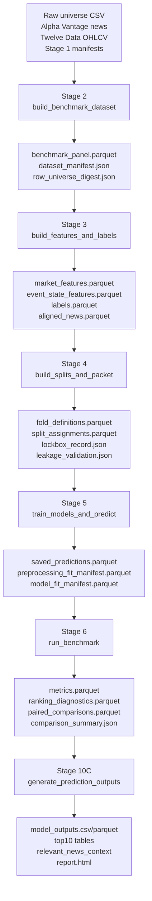
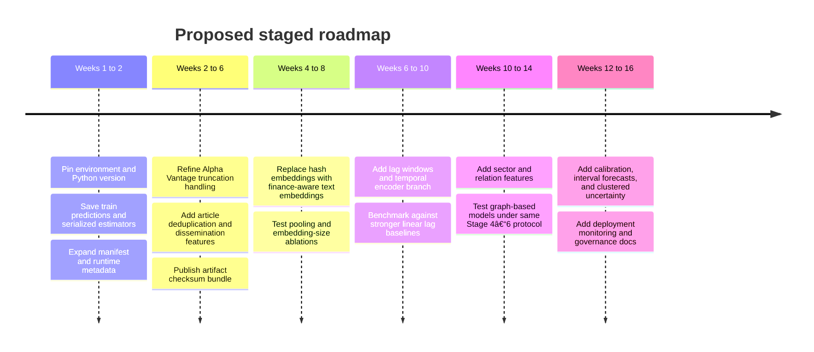

# Deep Research Report on ValdiviaEng Financial Event State Forecasting

## Executive summary

The repository implements a staged, artifact-driven research pipeline for **end-of-day, multi-horizon forward excess-return forecasting** over a frozen **top-50 liquid large-cap universe**, using **Alpha Vantage news** and **Twelve Data OHLCV** as the primary phase-one inputs. The design is unusually explicit about governance, data separation, and benchmark integrity: Stage 2 builds a manifest-backed benchmark panel, Stage 3 creates market and event-state features plus labels, Stage 4 creates **purged-plus-embargoed walk-forward folds** plus a final untouched lockbox, Stage 5 fits a frozen comparator roster and saves only out-of-sample predictions, Stage 6 computes the serious benchmark packet, and Stage 10C generates local historical-prediction output packets. The active interface is not notebooks or a service API; it is a local CLI plus versioned artifacts. fileciteturn4file0 fileciteturn9file0 fileciteturn10file0

The strongest technical virtue of the repository is **evaluation discipline**. It preserves explicit row identities across branches, uses fold-local preprocessing, blocks training-stage metrics from contaminating reporting, and enforces a final lockbox. Those controls are materially stronger than what many financial prediction repositories document. The main architectural weakness is the modeling stack itself: the event representation is a **deterministic 8-dimensional hash embedding** pooled over aligned articles, and the only event-aware model is a small **ridge-based gated-fusion regressor** layered on top of simple market features. There is no pretrained financial language model, no temporal sequence encoder, no cross-asset graph structure, no probabilistic forecasting, and no hyperparameter search. fileciteturn14file0 fileciteturn21file0 fileciteturn13file0 fileciteturn20file0

The repository’s current reported benchmark outcome is negative in a scientifically useful way. Stage 6 reports **`clean_null`**, with **0/3 primary short-horizon improvements** for the event-state model in both validation and lockbox, and a **`limitation_bearing`** comparability classification. The strict market hurdles chosen per horizon were mostly **elastic net** and, for 5-day, **ridge**. In other words, the current implementation does **not** show that the present event-state features add reliable incremental value over strong regularized market-only baselines under the repository’s serious evaluation protocol. fileciteturn40file0 fileciteturn17file0

Relative to recent literature, the repo is **conservative on scientific controls but behind on representation learning**. Over the last five years, the field has moved toward domain financial LMs such as **BloombergGPT** and **FinGPT**, LLM-based factor extraction and evidence reasoning, graph-based relational models for cross-asset structure, and large pretrained time-series models such as **TimesFM**, **Chronos**, **PatchTST**, **TSMixer**, and **Moirai**. Those approaches aim to absorb richer text semantics, longer temporal context, and zero-shot or few-shot transfer, though many published gains still depend heavily on dataset construction and weaker backtesting assumptions than the repo’s lockbox protocol. citeturn0academia0turn0academia3turn1academia3turn1academia2turn5academia0turn5academia2turn3academia0turn0academia1turn0academia2turn8academia1turn4academia1

My central conclusion is that the repository is already a **credible benchmark harness**, but not yet a competitive event-forecasting model. The highest-value next steps are to replace hash embeddings with finance-aware semantic encoders, add true temporal context to the market branch, save full reproducibility artifacts, and upgrade evaluation to include stronger uncertainty, ranking, and deployment diagnostics. Those changes are likely to improve both performance and scientific interpretability more than incremental tuning of the current gated-fusion ridge architecture. fileciteturn14file0 fileciteturn20file0 fileciteturn40file0 citeturn0academia0turn0academia3turn3academia0turn0academia1turn4academia1

## Repository architecture and file map

The repo is organized as a **stagewise benchmark factory** rather than a monolithic training script. The architecture docs describe the current executable paths as Stage 2 dataset-building, Stage 3 features/labels, Stage 4 split and packet gates, Stage 5 model/preprocessing/saved-prediction generation, Stage 6 reporting, Stage 7C contextual-bandit diagnostics, Stage 8 plan-first raw update scripts, and Stage 10C historical-prediction packet generation. The same docs explicitly state that many other future layers remain comment-only scaffolds and should not be mistaken for implemented behavior. fileciteturn10file0 fileciteturn11file0

A concise file-level map of the active research path is below.

| Layer | Key files | What they do |
| --- | --- | --- |
| Repository truth and runbooks | `README.md`, `UsageManual.md`, `docs/Architecture_Map.md` | Define current state, safe commands, artifact roots, non-claims, and active executable boundaries. fileciteturn4file0 fileciteturn9file0 fileciteturn10file0 |
| Stage 2 dataset contract | `src/event_state_forecasting/dataset/panel_builder.py`, `src/event_state_forecasting/cli/build_benchmark_dataset.py` | Build the benchmark panel from top-50 universe, Twelve Data OHLCV, Alpha Vantage news counts, clean window, manifests, and row digests. fileciteturn31file0 fileciteturn6file0 |
| Stage 3 feature engineering | `configs/features.yaml`, `configs/labels.yaml`, `src/.../features/market.py`, `event_state.py`, `news_alignment.py`, `embeddings.py`, `labels.py`, `cli/build_features_and_labels.py` | Define alignment rules, hash embeddings, scalar event enrichments, market-only features, and forward excess-return labels. fileciteturn14file0 fileciteturn15file0 fileciteturn25file0 fileciteturn26file0 fileciteturn28file0 fileciteturn27file0 fileciteturn30file0 fileciteturn19file0 |
| Stage 4 evaluation protocol | `configs/splits.yaml`, `src/.../split/purged_embargo.py`, `cli/build_splits_and_packet.py` | Create monthly expanding folds, 60-trading-day purge/embargo, final 20% lockbox, leakage checks, and runner gates. fileciteturn16file0 fileciteturn33file0 fileciteturn32file0 |
| Stage 5 modeling | `configs/models.yaml`, `models/comparator_ladder.py`, `market_baselines.py`, `gated_fusion.py`, `training.py`, `cli/train_models_and_predict.py` | Freeze the model roster, fit train-only preprocessors, train estimators, and save only validation/lockbox predictions plus manifests. fileciteturn13file0 fileciteturn24file0 fileciteturn22file0 fileciteturn21file0 fileciteturn23file0 fileciteturn20file0 |
| Stage 6 reporting | `configs/evaluation.yaml`, `evaluation/regression.py`, `ranking.py`, `statistical_tests.py`, `comparison_summary.py`, `cli/run_benchmark.py` | Compute RMSE/MAE/R², ranking diagnostics, paired loss deltas, overfitting diagnostics, comparison summary, and comparability classification. fileciteturn17file0 fileciteturn35file0 fileciteturn36file0 fileciteturn37file0 fileciteturn38file0 fileciteturn34file0 |
| Stage 10C local packet | `cli/generate_prediction_outputs.py`, `stage10/prediction_outputs.py` | Build historical-prediction output packets, top-10 tables, news context, trajectory markers, static HTML, and validation reports. fileciteturn47file0 fileciteturn48file0 |

The repository’s active control flow can be summarized as:



This flow is directly consistent with the README, Usage Manual, architecture map, and the stage CLIs themselves. fileciteturn4file0 fileciteturn9file0 fileciteturn10file0 fileciteturn6file0 fileciteturn19file0 fileciteturn32file0 fileciteturn20file0 fileciteturn34file0 fileciteturn47file0

## Data, features, models, and reported experiments

The benchmark family is fixed around **forward excess returns** for horizons **1d, 5d, 10d, 20d, and 60d**, over a reproducible **top-50** universe, with **SPY** used as a support ticker but excluded from dataset rows. The Stage 2 materialization log reports a clean window of **2024-04-01 through 2026-02-13**, **471** common as-of dates, and **117,750** rows total, which is exactly **23,550** rows per horizon. It also records that Stage 2 preserves no-news rows, flags Alpha Vantage truncation risk, and leaves split adjustment unresolved at this stage. fileciteturn43file0 fileciteturn31file0

Stage 2 is not merely a raw join. Its `panel_builder.py` computes the common price calendar across the top-50 plus SPY, enforces endpoint availability for the maximum 60-day horizon, carries row-level metadata such as prediction timestamps, label windows, split placeholders, no-news flags, provider truncation flags, and benchmark reference ticker, and writes both a manifest and a row-universe digest. It also includes a narrowly scoped derived-cleaning policy for a CVX OHLC anomaly without mutating raw input files. That contract discipline is unusually explicit for an academic-style forecasting repository. fileciteturn31file0

Stage 3 turns the panel into separate **market**, **event-state**, **labels**, and **aligned-news** artifacts. Market features are intentionally small: open, high, low, close, volume, intraday return, and intraday range ratio, all computed from same-row as-of-close values only. News alignment is equally explicit: articles published on a trading day at or before **16:00 America/New_York** align to that same day, while after-close and non-trading-day articles roll forward to the next trading date. fileciteturn25file0 fileciteturn28file0 fileciteturn14file0

The event-state representation is the clearest modeling bottleneck. Each aligned article is converted into a **deterministic SHA-256 hash embedding**, truncated to an **8-dimensional vector** with values scaled to `[-1, 1]`; aligned articles for a row are then mean pooled. The repo supplements that vector with scalar features such as aligned-news count, provider empty-feed flag, provider truncation-risk flag, minutes since latest aligned article, `no_news_flag`, and `empty_event_state_flag`. This choice is deterministic and reproducible, but it discards nearly all semantic structure that modern finance-language models can capture. fileciteturn27file0 fileciteturn26file0 fileciteturn14file0

The Stage 3 materialization log reports **67,840 aligned news records**, **46,330 rows with aligned news**, **71,420 no-news rows** after alignment, **59,610 provider truncation-risk rows preserved**, and an event-state vector dimension of **8**. Labels are computed as **ticker forward simple return minus leave-one-out equal-weight forward simple return of the rest of the approved universe**, not versus SPY. That is a reasonable research choice for cross-sectional relative forecasting, and it helps explain why a “zero excess return” baseline is meaningful. fileciteturn42file0 fileciteturn30file0 fileciteturn15file0

Stage 4 defines the evaluation protocol. The split config and materialization log show **monthly** expanding development folds, **126** initial training dates, **21** validation dates per fold, **60** trading dates for purge/embargo, and a final **20%** untouched lockbox spanning **2025-09-30 through 2026-02-13**. This produces **9** folds and **1,059,750** split assignments. Purged rows are those whose label windows overlap validation; embargoed rows are the 60 trading dates immediately before each validation block. fileciteturn16file0 fileciteturn44file0 fileciteturn33file0

Stage 5 freezes a comparator ladder of **8** model IDs and deliberately uses a tiny fixed, no-search regime: constant zero, constant train mean, ridge, elastic net, random forest, histogram gradient boosting, MLP, and one event-aware model called `event_state_gated_fusion`. The seed is **1729**, hyperparameter search attempts are **0**, preprocessing is train-only, and predictions are saved only for **validation** and **lockbox**. This means the repo values comparability and anti-overfitting discipline over aggressive model optimization. fileciteturn13file0 fileciteturn24file0 fileciteturn20file0

The `SimpleGatedFusionRegressor` is small and interpretable. It fits one ridge model on market features, one ridge model on event-state features, and then a third ridge combiner on the pair of branch predictions plus selected event-state gate features and their interactions. In effect, it is a shallow two-branch late-fusion model, not a transformer, sequence encoder, or deep multimodal architecture. That simplicity is attractive for benchmarking, but it is far below the representational capacity of recent event-driven financial models. fileciteturn21file0

Stage 6 evaluates the saved predictions using a predeclared policy. Primary regression metrics are **RMSE**, **MAE**, **out-of-sample R²**, and **mean loss difference versus the selected market hurdle**. Secondary ranking diagnostics are **Spearman rank IC**, **Kendall rank correlation**, **directional hit rate**, and **top-minus-bottom spread**. Paired comparisons deliberately omit p-values and instead report standard errors and positive-row rates. The result-class policy uses the short horizons **1d**, **5d**, and **10d** as the primary classification subset while still reporting all five horizons. fileciteturn17file0 fileciteturn35file0 fileciteturn36file0 fileciteturn37file0 fileciteturn38file0

The Stage 6 reporting log is the key experiment result. It reports **800 metric rows**, **800 ranking diagnostic rows**, **800 paired comparison rows**, **0/3** primary positive horizons in validation, **0/3** in lockbox, and a final classification of **`clean_null`** with **`limitation_bearing`** comparability and a **passed** serious packet. The chosen market hurdles were **elastic net** for **1d**, **10d**, **20d**, and **60d**, and **ridge** for **5d**. The event-state gated-fusion model did not beat the selected market hurdle on both primary loss deltas for any short horizon in either validation or lockbox. fileciteturn40file0

Artifacts are rich even though trained model binaries are not saved. Stage 5 writes **saved predictions**, **preprocessing-fit manifests**, **model-fit manifests**, **training diagnostics**, a **search-space summary**, and per-fold **preprocessing parameter JSONs**. The documentation does **not** describe persisted sklearn checkpoint binaries as part of the approved interface. Likewise, the active interface model is CLIs plus artifacts; the documents I inspected do **not** document a notebook-based workflow as an active interface. Stage 10C adds a historical-prediction output packet with CSV/Parquet tables, relevant-news context, trajectory markers, a limitations file, and a static `report.html`, but it is explicitly **not** live inference or trading advice. fileciteturn9file0 fileciteturn20file0 fileciteturn47file0 fileciteturn48file0

## Reproducibility and validation assessment

The repository provides a clear stagewise command path. The minimal end-to-end serious benchmark path is:

```powershell
python scripts/validate_agent_governance.py
python scripts/validate_stage2_inputs.py

$env:PYTHONPATH="src"; python -m event_state_forecasting.cli.build_benchmark_dataset
python scripts/validate_stage2_completion.py

$env:PYTHONPATH="src"; python -m event_state_forecasting.cli.build_features_and_labels
python scripts/validate_stage3_completion.py

$env:PYTHONPATH="src"; python -m event_state_forecasting.cli.build_splits_and_packet
python scripts/validate_stage4_completion.py

$env:PYTHONPATH="src"; python -m event_state_forecasting.cli.train_models_and_predict
python scripts/validate_stage5_completion.py

$env:PYTHONPATH="src"; python -m event_state_forecasting.cli.run_benchmark
python scripts/validate_stage6_completion.py
```

Those commands are directly documented in the README and Usage Manual, and Stage 6’s log also records `py_compile`, targeted evaluation tests, the benchmark CLI invocation, and completion validation. fileciteturn4file0 fileciteturn9file0 fileciteturn40file0

The documented software dependencies are incomplete but inferable. The Usage Manual names `pandas`, `numpy`, `pyarrow`, `yaml`/`PyYAML`, and `pytest`, while the active code path clearly imports **scikit-learn** for ridge, elastic net, random forest, histogram gradient boosting, MLP, imputers, and scalers. What is missing is a **pinned environment**: no package lock, no explicit Python version, no OS matrix, no container recipe, and no hardware/runtime envelope were surfaced in the files I inspected. That is a meaningful reproducibility gap. fileciteturn9file0 fileciteturn22file0 fileciteturn23file0 fileciteturn20file0

A second gap is **data reproducibility**. The benchmark contract depends on local raw trees under `data/raw/alphavantage` and `data/raw/twelvedata`, Stage 1/2 manifests, and in some update paths API keys for Alpha Vantage and Twelve Data. The repo explicitly warns that some raw ledgers and logs can contain API-key-bearing URLs and should not be shared. That is good operational hygiene, but it also means another researcher cannot reproduce the pipeline from code alone unless they reconstruct the same raw provider snapshots and manifest chain. fileciteturn9file0 fileciteturn4file0

A third gap is **diagnostic incompleteness**. The Stage 6 comparison logic explicitly marks the train-validation gap as blocked because Stage 5 saves only out-of-sample validation and lockbox predictions. This is scientifically defensible if the goal is pure out-of-sample reporting, but it prevents one important overfitting diagnostic that the repo itself considers part of the Option B contract. Also, paired comparisons report no p-values, which avoids misuse but weakens formal statistical inference. fileciteturn38file0 fileciteturn40file0 fileciteturn17file0

The main reproducibility gaps are summarized here.

| Gap | Why it matters | Severity | Recommended fix |
| --- | --- | --- | --- |
| No pinned environment file surfaced | Exact package versions can materially change sklearn and PyArrow behavior. | High | Add `pyproject.toml` or `requirements.lock`, Python version, and tested platform matrix. |
| Raw provider data and manifests are required | Code alone is not enough to reproduce the exact benchmark rows and provider flags. | High | Publish a redacted reproduction manifest bundle and checksums for each artifact root. |
| No persisted trained-model checkpoints | You can inspect predictions and preprocessors, but not replay model internals directly. | Medium | Save serialized estimators per fold/horizon/model with digests. |
| No train predictions | Blocks train-vs-validation diagnostic. | Medium | Save in-sample train predictions separately, with clear “not for metric selection” labeling. |
| No formal significance testing | Loss deltas are useful, but uncertainty claims remain limited. | Medium | Add block bootstraps or date-clustered confidence intervals; keep them secondary, not selection-driving. |
| Cross-platform shell guidance is thin | Commands are PowerShell-oriented. | Low | Add POSIX shell examples and a one-command reproducibility script. |

The comparison below is the fairest interpretation of **reported repository outcomes versus what strong baselines would normally be expected to do**, given that the inspected docs did **not** expose the raw numeric RMSE/MAE tables themselves.

| Benchmark dimension | Reported in repo | What a strong baseline would typically be expected to show | Assessment |
| --- | --- | --- | --- |
| Dominant market-only comparator | Elastic net wins 4 horizons; ridge wins 5-day. fileciteturn40file0 | In low-signal tabular finance, regularized linear models are often hard to beat and frequently outperform fancier small-data models. citeturn8academia1turn0academia2 | Plausible and not surprising. |
| Event-aware short-horizon improvement | 0/3 primary horizons in validation; 0/3 in lockbox. fileciteturn40file0 | If news semantics are genuinely additive, one would hope for at least some short-horizon wins; many recent papers report such gains, but often under looser protocols. citeturn1academia2turn1academia3turn5academia0turn5academia2 | Current event-state branch is not competitive enough. |
| Result class | `clean_null`. fileciteturn40file0 | A robust positive result would require persistent short-horizon gains under a frozen lockbox rule. fileciteturn17file0 | Negative result is credible. |
| Comparability | `limitation_bearing`. fileciteturn40file0 | A “comparable” benchmark normally requires complete packet evidence, complete diagnostics, and fewer upstream data limitations. | The benchmark is usable, but caveated. |
| Ranking diagnostics | Computed, but values were not surfaced in inspected docs. fileciteturn40file0 | In cross-sectional finance, rank-based metrics are often more informative than pure RMSE. | The repo measures the right secondary diagnostics, but the surfaced report is too coarse. |

## Comparison with recent research and industry practice

The repo’s current event-state design is much simpler than modern finance-NLP practice. **BloombergGPT** shows the value of domain-specific pretraining on a very large mixed corpus for financial NLP tasks, while **FinGPT** focuses on open, internet-scale financial data pipelines and domain adaptation. More recent finance-specific work pushes further into forecasting rather than generic NLP: **LLMFactor** uses prompting to extract market-relevant factors from news; a 2024 multimodal LLM study combines financial statements, price history, and retrieved news; and a 2024 FinGPT paper adds dissemination-aware and context-enriched prompting to improve short-term movement prediction. The repo, by contrast, reduces each article to an 8-dimensional hash vector and therefore gives up the very semantic structure these newer methods exploit. citeturn0academia0turn0academia3turn1academia3turn1academia1turn1academia2 fileciteturn27file0 fileciteturn26file0

On the pure time-series side, the broader forecasting literature has moved toward stronger temporal backbones. **PatchTST** uses patching and channel independence to improve long-context forecasting; **TSMixer** shows that simple MLP-mixers can be highly competitive for multivariate forecasting; **TimesFM** demonstrates a decoder-only time-series foundation model; **Chronos** frames forecasting as sequence modeling with tokenized time-series values; and **Moirai** pushes a universal pretrained transformer trained on a very large time-series archive. The repository uses none of those ideas. Its market branch sees only same-row OHLCV plus two derived intraday statistics, so it cannot learn medium- or long-range temporal patterns except indirectly through stagewise cross-sectional sampling. citeturn0academia2turn8academia1turn3academia0turn0academia1turn4academia1 fileciteturn25file0

Cross-sectional relational structure is another gap. Recent stock prediction work increasingly uses graph formulations. **THGNN** learns temporal and heterogeneous relationships among assets, and **MDGNN** models multi-relational, dynamic stock graphs to incorporate evolving dependencies. The repository does preserve a cross-sectional benchmark framing through excess-return labels, but the model itself has no sector, supplier-customer, ownership, or learned contemporaneous asset graph. It therefore cannot use the company-relation effects that many recent stock models rely on. citeturn5academia2turn5academia0 fileciteturn30file0

The interesting part is that the repository is probably **better than many papers on evaluation hygiene**. Recent papers frequently report strong gains, but the literature is heterogeneous in data cleaning, leakage control, and out-of-sample design. This repo’s insistence on fold-local preprocessing, saved prediction artifacts, a final untouched lockbox, and explicit non-claims is a major scientific strength. So the correct comparison is not “repo bad, literature good.” It is “repo stronger on benchmark discipline, weaker on representation learning.” That combination is actually promising, because a stronger model dropped into this evaluation harness would yield more credible evidence than many published stock-forecasting results. fileciteturn10file0 fileciteturn32file0 fileciteturn20file0 fileciteturn34file0 citeturn1academia2turn1academia3turn5academia0turn5academia2

A practical comparison is below.

| Method family | Representative recent source | Likely advantage over current repo | Likely downside |
| --- | --- | --- | --- |
| Finance-domain LMs | BloombergGPT, FinGPT. citeturn0academia0turn0academia3 | Much richer text semantics, entity understanding, and domain context than hash embeddings. | Larger compute, prompt design complexity, data licensing concerns. |
| Finance event reasoning with LLMs | LLMFactor, dissemination-aware FinGPT, RETuning. citeturn1academia3turn1academia2turn1academia0 | Better extraction of causal or explanatory event structure from news. | Harder reproducibility; more moving parts; prompt leakage risk. |
| Temporal forecasting backbones | PatchTST, TSMixer, TimesFM, Chronos, Moirai. citeturn0academia2turn8academia1turn3academia0turn0academia1turn4academia1 | Better long-context and multiscale time-series modeling than same-row OHLCV features. | Often not finance-specific; may need careful adaptation to cross-sectional excess returns. |
| Graph and relation models | THGNN, MDGNN. citeturn5academia2turn5academia0 | Can exploit sector and inter-firm dependence missing in the current roster. | Added complexity, more leakage surfaces, graph construction choices matter. |
| Noise-robust preprocessing | Diffusion denoiser and related denoising work. citeturn10academia0 | Could improve low signal-to-noise financial targets before downstream modeling. | Additional model stage; unclear gains without careful walk-forward validation. |

## Improvement roadmap

The repo does **not** need to abandon its benchmark discipline. It needs to **upgrade the model and data interfaces while preserving the same anti-leakage scaffold**. The items below are ordered by expected value relative to effort.

| Priority | Proposed change | Recommended experiments and hyperparameters | Expected impact | Effort | Risk |
| --- | --- | --- | --- | --- | --- |
| Highest | Replace hash embeddings with finance-aware semantic embeddings | Compare current 8-d hash baseline with frozen embeddings from a finance LM or sentence encoder derived from BloombergGPT/FinGPT-style domain text; test dimensions 128, 256, 768; try mean pooling and attention pooling; preserve identical Stage 4–6 protocol. citeturn0academia0turn0academia3turn1academia2 | High | Medium | Medium |
| Highest | Add temporal sequence context to the market branch | Replace same-row market features with rolling windows such as 20, 60, 126 trading days; benchmark TSMixer/PatchTST-style encoders, a small TimesFM/Chronos-inspired adapter, and simple lag-feature linear baselines first. citeturn8academia1turn0academia2turn3academia0turn0academia1 | High | Medium to High | Medium |
| High | Save full reproducibility artifacts | Persist serialized estimators, train predictions, environment lockfile, artifact checksums, and runtime metadata. This directly fixes current validation gaps. fileciteturn20file0 fileciteturn38file0 | High for scientific credibility | Low | Low |
| High | Improve news quality and event features | Execute truncation refinement, article deduplication, story-cluster features, dissemination breadth, and recency-decay features; test event count caps and time-decay half-lives such as 30, 120, 360 minutes. fileciteturn4file0 citeturn1academia2 | Medium to High | Medium | Medium |
| Medium | Add cross-sectional relation modeling | Start with sector/industry adjacency and market-cap similarity before dynamic graphs; then test THGNN/MDGNN-style relational layers under the same fold rules. citeturn5academia2turn5academia0 | Medium | High | High |
| Medium | Upgrade losses and reporting | Add rank-oriented loss, quantile loss, calibration metrics, clustered confidence intervals, turnover-aware backtests, and stability slices by news/no-news/truncation-risk rows. | Medium | Medium | Low to Medium |
| Medium | Deployment hardening | Add cut-off enforcement, feature-store schema checks, model cards, drift monitoring, and a “research-only vs advisory-use” boundary document. fileciteturn9file0 fileciteturn48file0 | Medium | Medium | Medium |

A sensible sequencing is:



In deployment terms, the current repository should remain **research-only** until three conditions are met: first, semantic and temporal upgrades beat the selected market hurdle on the same strict lockbox protocol; second, full reproducibility artifacts exist; third, operational monitoring and claim boundaries are documented. The current Stage 10C packet is explicitly a **historical-prediction** extractor, not a production forecasting service, so it should not be reinterpreted as deployment evidence. fileciteturn48file0 fileciteturn4file0

## Ethical, regulatory, and data privacy considerations

The repository itself already surfaces one important ethical point: **do not overclaim**. The README, Usage Manual, Stage 6 report, and Stage 10C code repeatedly state that the current benchmark is not a positive profitability claim, not live inference, not trading advice, and not a product API. That self-restraint is appropriate. In finance, a technically interesting model can still be misleading if its evaluation is weak or if marketing outruns evidence. fileciteturn4file0 fileciteturn9file0 fileciteturn40file0 fileciteturn48file0

On model governance, the strongest external reference is the Federal Reserve’s **SR 11-7** guidance. It says banking organizations should manage model risk through robust development, effective validation, and sound governance; it emphasizes independent validation, ongoing monitoring, benchmarking to alternatives, and outcomes analysis at a frequency matching the model’s forecast horizon. Those principles map directly onto what this repository is trying to do with saved predictions, lockbox isolation, leakage controls, and post-hoc comparison. If this work were ever operationalized in a regulated institution, SR 11-7-style governance would be highly relevant. citeturn16view0

There is also a communications risk. In 2024, the SEC settled charges with two investment advisers over misleading AI-related statements, a case widely described as an “AI washing” warning shot. For a repo like this, that means any future claim of “AI-driven financial forecasting” should be backed by exact artifact versions, reproducible results, and careful non-claims about profitability and advisory use. The repository’s current habit of preserving those boundaries is a strength and should be retained. citeturn13news0 fileciteturn40file0

Data privacy in this repo is less about personal data and more about **operational secrets and provenance**. The docs explicitly warn that some Alpha Vantage and Twelve Data ledgers or logs can contain API-key-bearing URLs, and they call out `runs/logs/alphavantage_news_daemon.log` as sensitive until sanitized. Any reproducibility package or public artifact release therefore needs redaction, checksum-based verification, and a clean separation between benchmark evidence and provider secrets. fileciteturn4file0 fileciteturn9file0

Another ethical issue is **coverage bias and silent data incompleteness**. The repo does the right thing by preserving provider truncation-risk flags and explicitly refusing to claim provider-level article completeness. That matters because event-driven financial models can become biased if missing coverage is correlated with ticker, sector, exchange, or time period. A model that treats missing news as true “no news” without provenance metadata can learn the data vendor more than the market. This repo at least makes that risk visible. fileciteturn42file0 fileciteturn43file0

## Open questions and limitations

Some important information remained unavailable in the materials I could directly inspect. The most notable missing pieces are the **raw Stage 6 numeric metric tables** themselves, full Stage 5 materialization notes, a pinned environment specification, and an inspectable list of whether any notebooks exist outside the active documented interface. The docs clearly state what artifacts should exist, and the Stage 6 report confirms their presence, but not all underlying data files were directly inspectable through the connector path I used. fileciteturn40file0 fileciteturn9file0

Because of that limitation, my “reported metrics vs expected baselines” comparison had to stay at the level of **disclosed benchmark outcomes and selected hurdle models**, rather than quoting exact RMSE, MAE, RankIC, or top-minus-bottom spread values. That is a limitation of source access, not of the repo’s internal design. fileciteturn40file0

Within those limits, the evidence is still strong enough for the main conclusion: the repository is already a disciplined **benchmarking framework**, but the **current event-state representation and model family are too weak** to clear its own serious benchmark hurdle. The correct next move is not looser evaluation; it is stronger modeling inside the same rigorously controlled pipeline. fileciteturn40file0 fileciteturn21file0 fileciteturn14file0 citeturn0academia0turn0academia3turn3academia0turn0academia1turn4academia1
