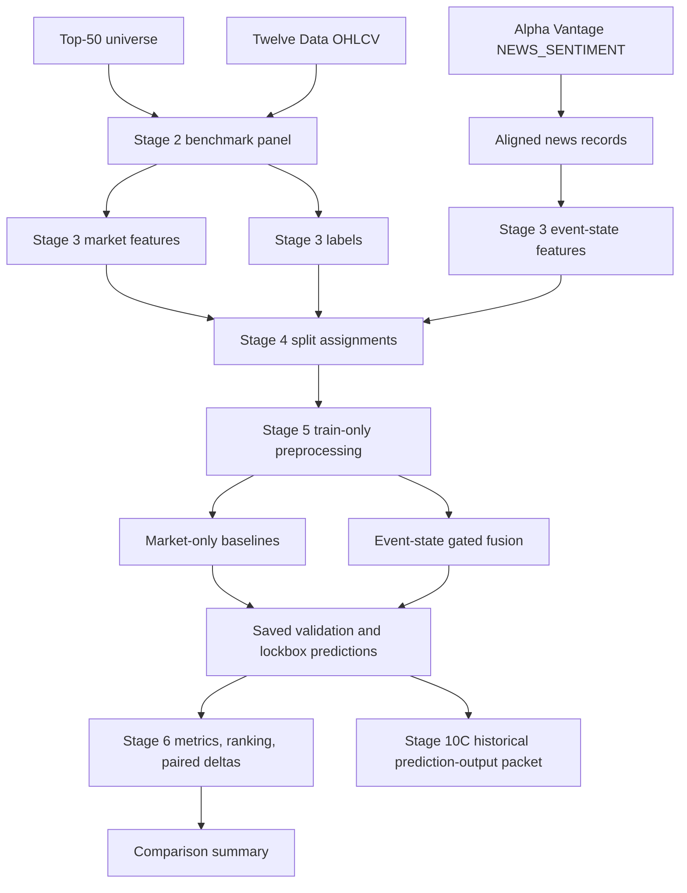
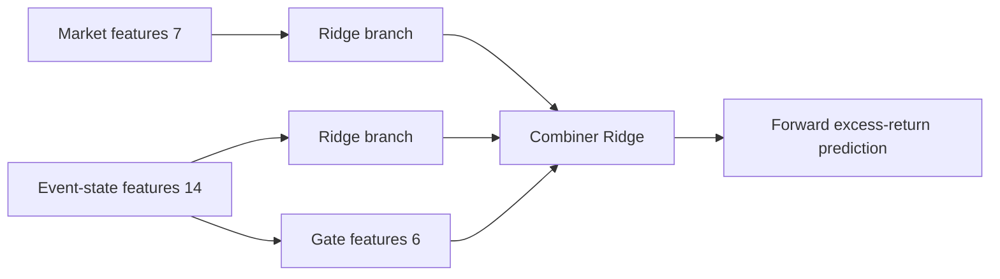
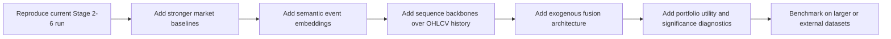

# Deep Research Report on ValdiviaEng Financial Event State Forecasting

## Executive Summary

Using the enabled connector set, I confirmed the target codebase is the GitHub repository **ValdiviaEng/financial-event-state-forecasting** and used that repository as the primary source of truth for the implementation review. The repository is best understood as a **carefully staged, leakage-aware research benchmark pipeline** for testing a narrow Phase-1 question: whether **event-state features derived from aligned financial news add incremental predictive value over market-only baselines** for **forward excess returns** across five horizons (`1d`, `5d`, `10d`, `20d`, `60d`) on a **top-50 liquid large-cap universe**. Its strongest qualities are not model novelty, but **experimental hygiene**: explicit artifact contracts, row-universe digests, purged-and-embargoed walk-forward splits, a final untouched lockbox, train-only preprocessing, saved out-of-sample predictions, and documented non-claims around provider completeness and trading use. fileciteturn8file0 fileciteturn9file0 fileciteturn20file0 fileciteturn32file0

Concretely, the repository materializes a Stage 2 dataset with **117,750 rows** over a clean window from **2024-04-01 to 2026-02-13**; Stage 3 adds market features, aligned-news event-state features, and forward excess-return labels while preserving the exact row universe; Stage 4 creates **9 monthly development folds** with purge/embargo plus a final **20% lockbox**; Stage 5 trains a frozen roster of **8 small scikit-learn models** and emits **2,088,000** saved validation/lockbox predictions; and Stage 6 computes regression metrics, ranking diagnostics, paired loss deltas, overfitting diagnostics, and a comparison summary. The Stage 6 result is explicitly documented as **`clean_null`**, meaning the event-state model did **not** clear the predeclared short-horizon hurdle relative to the selected market-only baselines; comparability is classified as **`limitation_bearing`** rather than invalid, mainly because provider completeness is unclaimed and the train-validation gap diagnostic is blocked by the intentional absence of saved train predictions. fileciteturn42file0 fileciteturn41file0 fileciteturn40file0 fileciteturn39file0 fileciteturn38file0

Methodologically, the repo is **conservative by design**. Its only event-state model is a **simple gated fusion regressor** that fits ridge models on market and event-state branches separately and then fits a ridge combiner over branch predictions plus a handful of gate features such as aligned-news count, no-news flags, truncation-risk flags, and recency. Event-state text representation is not a semantic encoder; it is an **8-dimensional deterministic hash embedding** pooled across aligned articles. That makes the benchmark easy to reproduce and resistant to hidden model drift, but it also leaves substantial performance on the table relative to recent work using **patch-based transformers, exogenous-variable transformers, multimodal gated cross-attention, graph-based relational models, financial LLMs, and pretrained time-series foundation models**. fileciteturn14file0 fileciteturn18file0 fileciteturn27file0 fileciteturn29file0 citeturn5view0turn5view1turn6view1turn7view0turn11view2turn18academia2turn19academia2

From a broader research perspective, the repository is closer to a **high-integrity benchmark harness** than to contemporary forecasting SOTA. That is a valid and, in many ways, commendable choice. The bigger opportunity is to preserve the repository’s excellent evaluation discipline while upgrading four areas: **richer text/event representations, stronger sequential market encoders, more competitive tabular/sequence baselines, and more realistic external benchmarking**. The strongest practical extension path is not to abandon the current pipeline but to **swap in stronger model families under the same frozen splits and artifact contracts** so that new claims remain comparable. Recent benchmark trends also reinforce this: the M6 competition underscores how difficult live financial forecasting remains, while newer datasets such as FinMultiTime expand the scale, modality breadth, and reproducibility expectations for multimodal financial forecasting research. citeturn11view1turn11view0

## Repository Confirmation and Architecture

The repository’s own architecture documents describe an active-root design with a clear separation between governance, scope/truth documents, executable pipeline code, configs, tests, data artifacts, and historical archived material. The primary executable code lives under `src/event_state_forecasting/`, with major layers for `data`, `dataset`, `features`, `split`, `models`, `evaluation`, `stage7`, `stage10`, and `cli`; active configs live under `configs/`; validators and operational scripts live under `scripts/`; and executable tests exist for Stage 2 through Stage 8 and Stage 10C. The repository repeatedly warns that **only explicitly approved executable paths** should be treated as implemented behavior, and that all remaining scaffold files are comment-only and must not be cited as active functionality. fileciteturn8file0 fileciteturn53file0

At the highest level, the implemented Phase-1 data flow is: define a frozen top-50 universe; ingest OHLCV from Twelve Data and news from Alpha Vantage; validate raw/provider conditions; create aligned market and event-state feature rows on an identical as-of panel; generate forward excess-return labels; create purged, embargoed walk-forward splits plus lockbox; fit fold-local preprocessors and frozen models; save all out-of-sample predictions; evaluate only from those saved predictions against frozen labels; and finally generate a Stage 10C packet that exposes historical prediction outputs without relabeling them as live forecasts or trading signals. fileciteturn8file0 fileciteturn25file0 fileciteturn47file0



A compact view of the repository’s active areas is below.

| Area | Purpose | Status |
|---|---|---|
| `docs/`, root truth/governance files | Scope, theory, architecture, execution, decisions | Active |
| `src/event_state_forecasting/dataset` | Stage 2 panel materialization | Active |
| `src/event_state_forecasting/features` | Stage 3 market/event-state features and labels | Active |
| `src/event_state_forecasting/split` and `benchmark` | Stage 4 splits, leakage validation, packet gates | Active |
| `src/event_state_forecasting/models` | Stage 5 preprocessors, baselines, gated fusion, saved predictions | Active |
| `src/event_state_forecasting/evaluation` | Stage 6 metrics, ranking diagnostics, comparisons, result classification | Active |
| `src/event_state_forecasting/stage10` | Historical prediction-output packet generation | Active |
| `configs/` | Stage 3–7 and Stage 10-related configs | Active |
| `tests/` | Focused executable tests by stage | Active for approved paths |
| `deprecated_version/legacy_snapshot_*` | Historical reference implementation | Reference-only |

The table summarizes the architecture map and guidebook, not an inferred directory tree. fileciteturn8file0 fileciteturn53file0

## Data Design and Experimental Pipeline

The dataset contract is unusually explicit. The Stage 2 benchmark panel requires a stable row-key tuple of `benchmark_family_id`, `canonical_ticker`, `as_of_date`, and `horizon_id`, and it carries fields for prediction timestamp, feature availability timestamp, label-window bounds, split placeholders, lockbox/purge/embargo flags, preprocessing permissions, market data availability, news-provider status, aligned-news counts, and no-news/empty-event-state indicators. Stage 2 also adds raw OHLCV values and support-ticker data while preserving a row-level digest to enforce equality across branches. fileciteturn32file0 fileciteturn35file0

The realized Stage 2 artifact uses a **top-50 universe**, excludes support ticker **SPY** from benchmark rows, spans a clean window from **2024-04-01 to 2026-02-13**, contains **471 common as-of dates**, and materializes **117,750 rows**, or **23,550 per horizon**. This is one of the cleanest and most useful aspects of the repo, because every later artifact traces back to the same row-universe digest. fileciteturn42file0

Stage 3 then creates three aligned views over the identical row universe: `market_features.parquet`, `event_state_features.parquet`, and `labels.parquet`, plus an `aligned_news.parquet` audit table. Market features are intentionally minimal: open, high, low, close, volume, intraday return, and intraday range ratio, all restricted to same-row as-of-close information. Labels are **forward simple excess returns** defined as the stock’s forward simple return minus the leave-one-out equal-weight forward simple return of the other approved-universe members. Event-state features use **same-day as-of-close alignment**, with after-close or non-trading-day articles rolled forward to the next trading date. fileciteturn30file0 fileciteturn31file0 fileciteturn18file0 fileciteturn19file0 fileciteturn26file0

A particularly important design choice is the no-news policy. The repository does **not** drop rows without aligned articles. Instead, it keeps them in the same row universe and encodes them explicitly with `no_news_flag` and `empty_event_state_flag`, which is methodologically preferable because it avoids conditioning the event-state branch on “news exists.” The Stage 3 materialization report says the final artifact contains **67,840 aligned news records**, **46,330 rows with aligned news**, **71,420 no-news rows**, and **59,610 provider truncation-risk rows preserved**. fileciteturn28file0 fileciteturn41file0

The text side of the event-state representation is intentionally lightweight. Articles are normalized into records with `article_id`, `ticker`, `published_timestamp`, `aligned_as_of_date`, `roll_forward_reason`, `title`, `summary`, `url`, and `text_hash`. Each article text is converted into a deterministic **8-dimensional hash embedding**, and row-level event states are formed by mean-pooling all aligned article vectors and appending scalar enrichments such as article count, provider-empty-feed flag, provider-truncation-risk flag, minutes since the latest aligned article, and the no-news/empty-event flags. This is reproducible and highly stable, but it is **not** a semantic language representation in the modern sense. fileciteturn27file0 fileciteturn29file0 fileciteturn18file0

One practical caveat is provider completeness. Alpha Vantage’s official documentation for `NEWS_SENTIMENT` states that the endpoint returns **50 results by default** and at most **1,000 results** per query, ordered by latest/earliest/relevance. The repo accordingly does **not** claim provider-level completeness; instead, it tracks truncation risk explicitly. Repository evidence states that canonical top-50 raw coverage reached **850/850** ticker-year/current files, but **92** canonical windows are flagged as likely truncated and **10** as empty feeds. This is a serious data-quality limitation, but the repo handles it honestly rather than pretending the issue does not exist. citeturn17view1turn17view2turn16view0 fileciteturn9file0 fileciteturn36file0 fileciteturn53file0

A concise schema summary is below.

| Artifact | Key columns or fields | Notes |
|---|---|---|
| Stage 2 `benchmark_panel.parquet` | row key, timestamps, horizons, split placeholders, no-news flags, provider flags, OHLCV, benchmark close | Materialized panel, not yet labels/splits/results |
| Stage 3 `market_features.parquet` | OHLCV + intraday derived market features | Same-row as-of-close only |
| Stage 3 `event_state_features.parquet` | aligned news count, provider flags, recency, 8 hash-embedding dims, no-news flags | Mean pooled over aligned articles |
| Stage 3 `labels.parquet` | label-window bounds, ticker return, leave-one-out reference return, forward excess return, label availability | Five supported horizons |
| Stage 5 `saved_predictions.parquet` | row key, fold/split role, model ID/family/branch, artifact versions, prediction | Validation and lockbox only |
| Stage 10C `model_outputs.*` | event-state and market-hurdle predictions, deltas, ranks, percentiles, news-context metadata | Historical outputs only, not live forecasts |

The schema summary above is derived directly from the repository contracts and implementation modules. fileciteturn32file0 fileciteturn26file0 fileciteturn56file0 fileciteturn25file0

## Models, Evaluation, and Reproducibility

The Stage 5 model roster is frozen in `configs/models.yaml` as `phase1_top50_pragmatic_broader_sklearn_v1`, with **seed `1729`** and a search policy of **`tiny_fixed_no_hyperparameter_search`**. The market-only branch contains seven models: constant-zero excess return, train-mean, ridge, elastic net, random forest, histogram gradient boosting, and a small MLP. The only event-state model is `event_state_gated_fusion`. There is **no hyperparameter search**, no neural text encoder, no probabilistic forecasting, and no deep temporal sequence model in the active benchmark family. fileciteturn10file0 fileciteturn16file0 fileciteturn39file0

| Model ID | Family | Branch | Inputs | Preprocessing | Fixed parameters |
|---|---|---|---|---|---|
| `market_zero_excess_return` | constant zero | market-only | market | none | none |
| `market_train_mean` | constant mean | market-only | market | none | none |
| `market_ridge` | ridge | market-only | market | median impute + scale | `alpha=1.0` |
| `market_elastic_net` | elastic net | market-only | market | median impute + scale | `alpha=1e-4`, `l1_ratio=0.15`, `max_iter=20000` |
| `market_random_forest` | random forest | market-only | market | median impute | `n_estimators=32`, `max_depth=6`, `min_samples_leaf=20`, `n_jobs=1` |
| `market_hist_gradient_boosting` | hist gradient boosting | market-only | market | median impute | `max_iter=60`, `learning_rate=0.05`, `max_leaf_nodes=15`, `l2_regularization=0.01` |
| `market_mlp` | MLP | market-only | market | median impute + scale | `hidden_layer_sizes=[16]`, `alpha=1e-4`, `lr_init=0.001`, `max_iter=80` |
| `event_state_gated_fusion` | simple gated fusion | event-state | market + event-state | median impute + scale | `alpha=1.0` |

The roster table is directly grounded in the model config and estimator factories. fileciteturn10file0 fileciteturn14file0 fileciteturn15file0

The event-state architecture is modest but well-defined. It first splits the feature matrix into market features and event-state features, fits one ridge model on each branch, then fits a third ridge combiner over the market-branch predictions, the event-state-branch predictions, the approved gate features, and interactions between the event-state prediction and those gate features. This is a clean low-capacity baseline for multimodal incremental-value testing, but it is far from modern multimodal representation learning. fileciteturn14file0



The split protocol is more sophisticated than the models. Stage 4 uses **monthly expanding-window validation**, **126 initial training dates**, **21-date validation windows**, **60 trading dates of purge/embargo**, and a **final 20% untouched lockbox** beginning on **2025-09-30**. The Stage 4 materialization report records **9 folds**, **1,059,750 split-assignment rows**, **47,250 validation rows across folds**, **472,500 training rows across folds**, **43,200 purged rows**, **91,800 embargoed rows**, and **191,250 excluded rows**. This is the repository’s scientific backbone. fileciteturn20file0 fileciteturn40file0

Stage 5 then fits all models fold-by-fold and horizon-by-horizon with train-only preprocessing. It produces **360 model-fit records**, **360 preprocessing-fit records**, and **2,088,000 saved prediction rows**, split into **378,000 validation** rows and **1,710,000 lockbox** rows. Seven Elastic Net fits emitted convergence warnings, which are captured in diagnostics rather than hidden. fileciteturn13file0 fileciteturn17file0 fileciteturn39file0

Stage 6 evaluates only from saved out-of-sample predictions aligned with frozen labels. Primary regression metrics are `rmse`, `mae`, `r2_oos`, and loss differences relative to a strict market hurdle; secondary diagnostics are `spearman_rank_ic`, `kendall_rank_correlation`, `directional_hit_rate`, and `top_minus_bottom_spread`. The strict market hurdle is chosen per horizon from the market-only models using validation RMSE and then MAE as tie-breakers. For this run, the selected hurdles were `market_elastic_net` at `1d`, `10d`, `20d`, and `60d`, and `market_ridge` at `5d`. The event-state model cleared **none** of the three primary horizons on both validation and lockbox, so the result class is `clean_null`. fileciteturn21file0 fileciteturn48file0 fileciteturn49file0 fileciteturn50file0 fileciteturn51file0 fileciteturn52file0 fileciteturn38file0

From a reproducibility standpoint, the repository is strong on **artifact lineage** and weaker on **environment capture**. Strengths include explicit manifests, row-universe digests, frozen configs, deterministic seed control, stage validators, focused stage tests, and a clear rule that benchmark claims require a full serious-run artifact packet. The main weaknesses are the absence of a clearly surfaced lockfile/container workflow in the inspected materials, the reliance on local path conventions, and the explicit Stage 6 diagnostic blocker caused by not saving train predictions. The Usage Manual does, however, give a workable local dependency set and stagewise command sequence, and the stage logs record passing validations for Stages 2 through 6 and 10C. fileciteturn7file0 fileciteturn13file0 fileciteturn39file0 fileciteturn38file0 fileciteturn54file0

## Comparison to Recent State of the Art

There is no single uncontested “SOTA” for financial event/state forecasting, because the field is fragmented across **cross-sectional stock-movement classification**, **numeric return regression**, **multimodal price-plus-text modeling**, and newer **foundation-model** settings. Even the M6 competition, which is one of the most relevant recent public references, emphasizes that financial forecasting remains difficult, that consistent outperformance is hard, and that forecast accuracy and investment utility are not the same thing. That caution aligns with the repo’s refusal to overclaim from a single benchmark run. citeturn11view1 fileciteturn38file0

Still, the gap between this repository and recent methods is clear. Modern forecasting backbones such as **PatchTST** use patching and channel independence for longer effective histories and stronger multivariate forecasting; **iTransformer** inverts the tokenization scheme so variates become tokens and reports strong multivariate performance; **TimeMixer** uses multiscale decomposition and mixing; **TimeXer** is explicitly designed for forecasting with exogenous variables; and **Chronos** shows that pretrained time-series transformers can deliver strong zero-shot or low-tuning performance across many datasets. None of those ideas is present in the current repo’s active benchmark family. citeturn5view0turn5view1turn6view0turn19academia2turn18academia2

On the finance-specific multimodal side, recent work has moved beyond pooled bag-of-article representations. **HIST** models shared information across stocks using concept-oriented graph structure; **MSGCA** uses multi-branch encoding plus gated cross-attention over indicators, documents, and relations; and the recent **FinGPT** line pushes language models toward context-enriched, dissemination-aware stock-movement prediction. These approaches are much closer to what many researchers now mean by “financial event-state forecasting” than the repo’s deterministic 8-dimensional hash embedding plus ridge combiner. citeturn7view0turn6view1turn11view2

Benchmarking standards are also moving. **FinMultiTime** proposes a much larger four-modal financial dataset across the S&P 500 and HS 300, covering **5,105 stocks** from **2009 to 2025** and reporting that scale, data quality, and multimodal fusion improve performance while enabling reproducible updates. Relative to that direction, the repository’s top-50 scope is tighter and scientifically cleaner for a first benchmark family, but far smaller in coverage and modality richness. citeturn11view0

The most important SOTA comparison, therefore, is not “this repo should have been a transformer from the start.” It is more specific: **the repo already has a better evaluation contract than much of the literature, but a weaker modeling stack than the current frontier**. In other words, its **benchmark shell is ahead of many papers**, while its **representation learning is behind**. That imbalance is actually useful, because it means the repository is well-positioned to become a strong comparison harness for stronger models. fileciteturn40file0 fileciteturn52file0 citeturn11view1turn11view0turn19academia2turn18academia2

A concise comparison appears below.

| System or paper | Year | Main idea | What it does better than the repo | What the repo still does better |
|---|---:|---|---|---|
| Repo `event_state_gated_fusion` | 2026 repo state | Ridge branch fusion with scalar gating | Simplicity, determinism | Strong artifact discipline and leakage control |
| HIST | 2021 | Graph-based shared stock information | Learns cross-stock structure | Repo has clearer lockbox and artifact governance |
| PatchTST | 2023 | Patch-based transformer for longer history | Better temporal modeling | Repo has finance-specific event-state wiring |
| iTransformer | 2024 | Variates-as-tokens transformer | Strong multivariate correlations | Repo has explicit lockbox and identical-row comparisons |
| TimeMixer | 2024 | Multiscale decomposition/mixing | Stronger temporal scale modeling | Repo has simpler interpretability and lower compute |
| TimeXer | 2024 | Forecasting with exogenous variables | Better endogenous/exogenous integration | Repo has more explicit no-news and leakage contracts |
| MSGCA | 2024/2025 | Gated cross-attention for multimodal stock prediction | Richer multimodal fusion | Repo has stricter non-claims and reproducibility artifacts |
| FinGPT stock-movement variant | 2024/2025 | Context-enriched LLM sentiment modeling | Better semantic text understanding | Repo has more stable/local reproducibility |
| Chronos | 2024 | Pretrained TS foundation model | Strong zero-shot forecasting backbone | Repo has finance-event semantics and row-level auditability |

The comparison table is a synthesis of the repo’s implementation and the cited primary papers. fileciteturn14file0 citeturn7view0turn5view0turn5view1turn6view0turn19academia2turn6view1turn11view2turn18academia2

## Recommendations and Reproduction Roadmap

The most valuable near-term change is to treat the current repo as a **benchmark harness** and plug in stronger models **without changing the split protocol, label family, lockbox policy, or artifact requirements**. That preserves comparability. The first modeling additions should be: a **strong tabular booster** such as LightGBM/XGBoost/CatBoost; a **sequence model** over longer OHLCV histories rather than same-day derived features only; and a **semantic event encoder** using a financial language model or at least contextual embeddings instead of hash vectors. The broader literature strongly suggests that exogenous-variable-aware architectures and stronger text representations matter, especially when the predictive signal lives in the interaction between market context and event flow. fileciteturn30file0 fileciteturn29file0 citeturn19academia2turn11view2turn6view1

Data improvements should focus on source quality and temporal context. The repo should continue to preserve provider flags, but it should also either refine Alpha Vantage truncation handling or introduce an additional news source for comparison, because the `NEWS_SENTIMENT` endpoint’s hard upper bound of **1,000 results** per query is a plausible cause of signal loss in high-news windows. It would also be worthwhile to store richer per-article metadata for future ranking and attribution experiments, and to add longer rolling market context windows so the model is not forced to infer everything from same-day OHLCV plus pooled news. citeturn17view1turn17view2 fileciteturn41file0

Evaluation should be upgraded in three ways. First, add **saved train predictions** or a comparable mechanism so the train-validation gap diagnostic is no longer blocked. Second, add **statistical confidence procedures** that respect dependence, such as block bootstrap or suitably adapted Diebold-Mariano-style comparisons, rather than stopping at mean loss deltas without p-values. Third, add realistic **portfolio-layer diagnostics** with turnover, concentration, and transaction-cost sensitivity, because M6-style evidence suggests that predictive skill and investment utility can diverge materially. fileciteturn38file0 fileciteturn52file0 citeturn11view1

For deployment and operationalization, the repo should remain honest about its current boundaries: it does **not** provide a user-facing API, dashboard, or live trading service, and Stage 10C generates **historical prediction-output packets** rather than newly computed future forecasts. But if the project later moves toward operational use, it needs pinned environments, containerization, CI for stage validators, sanitized request ledgers, schema versioning tests for raw provider changes, and explicit model cards that document non-claims and failure modes. fileciteturn8file0 fileciteturn25file0 fileciteturn47file0 fileciteturn53file0

A prioritized recommendation matrix is below.

| Priority | Recommendation | Why it matters | Expected impact |
|---|---|---|---|
| High | Replace hash embeddings with financial semantic embeddings | Current 8D hash vectors are reproducible but weak | Likely largest event-state gain |
| High | Add stronger market baselines and sequence models | Current market branch uses only same-day features and small sklearn models | Better hurdle quality and more credible null/positive findings |
| High | Keep same splits and lockbox while adding new models | Preserves scientific comparability | Makes extensions publishable and interpretable |
| High | Save train predictions or train losses | Removes explicit Stage 6 diagnostic blocker | Stronger overfitting diagnostics |
| Medium | Add portfolio utility diagnostics with costs | Connects forecast quality to actionability | Better external validity |
| Medium | Perform news-source/truncation ablations | Quantifies whether provider limitations suppress signal | Better data trustworthiness |
| Medium | Add sector/graph relational features | Modern finance methods exploit shared stock structure | Likely helps cross-sectional ranking |
| Medium | Package environment with lockfile and Docker | Improves reproducibility for third parties | Lower setup friction |
| Lower | Add probabilistic forecasts and calibration | Useful for risk-aware deployment | Important for later operational stages |

The roadmap below is the most faithful reproduction plan supported by the inspected repo evidence.

```bash
# Environment
python -m pip install pandas numpy pyarrow pyyaml scikit-learn pytest
# Windows PowerShell
$env:PYTHONPATH="src"

# Stage 2
python -m event_state_forecasting.cli.build_benchmark_dataset
python scripts/validate_stage2_completion.py --write

# Stage 3
python -m event_state_forecasting.cli.build_features_and_labels --allow-overwrite
python scripts/validate_stage3_completion.py --write

# Stage 4
python -m event_state_forecasting.cli.build_splits_and_packet
python scripts/validate_stage4_completion.py --write

# Stage 5
python -m event_state_forecasting.cli.train_models_and_predict
python scripts/validate_stage5_completion.py --write

# Stage 6
python -m event_state_forecasting.cli.run_benchmark
python scripts/validate_stage6_completion.py --write

# Stage 10C
python -m event_state_forecasting.cli.generate_prediction_outputs --run-date 2026-05-23 --data-cutoff 2026-02-13
python scripts/validate_stage10c_completion.py --write
```

The stagewise command pattern, validators, and observed pass states are documented in the usage and stage logs. fileciteturn7file0 fileciteturn39file0 fileciteturn38file0 fileciteturn24file0

Exact runtimes and hardware are **not published** in the inspected materials. The safest conclusion is that they are unknown. A cautious inference is that the current Stage 5 roster is **CPU-feasible** for a modern workstation because it uses small scikit-learn models, fixed tiny hyperparameters, and no hyperparameter search, although the total artifact volume is nontrivial because Stage 5 writes 2,088,000 prediction rows and Stage 4/6 also materialize multiple large parquet outputs. If you extend the repo with transformers or LLM-based text encoders, GPU assumptions will likely become necessary. This hardware judgment is an inference from the fixed model roster and artifact counts, not a documented benchmark. fileciteturn10file0 fileciteturn39file0

A sensible extension sequence would look like this:



Suggested visual aids for a future paper or internal memo are straightforward: one **pipeline architecture diagram**, one **split timeline diagram** showing training/validation/purge/embargo/lockbox, one **model comparison table** showing each branch and parameterization, one **per-horizon results table** with both validation and lockbox metrics, one **news-coverage quality table** with truncation/empty-feed counts, and one **Stage 10C sample output mockup** that clearly labels all rows as historical predictions rather than live forecasts. Those visual aids would improve interpretability without changing the underlying science. fileciteturn40file0 fileciteturn39file0 fileciteturn38file0 fileciteturn25file0

## Risks, Ethics, and Open Questions

The repository’s strongest ethical feature is that it is **explicitly conservative about claims**. It repeatedly states that Stage 6 is not evidence of trading profitability, that provider-level article completeness is unclaimed, that Stage 10C outputs are not trading advice, and that no user-facing service boundary exists. It also excludes sensitive artifacts such as raw request ledgers and URL-bearing logs from output packets. That is substantially better than the norm in many finance-model repositories. fileciteturn38file0 fileciteturn25file0 fileciteturn9file0

The main ethical and operational risks are subtler. First, incomplete or truncated news can bias apparent event effects in ways that are hard to diagnose. Second, using a small top-50 universe risks overfitting to a liquid large-cap regime rather than learning more general event-state behavior. Third, financial forecasting is highly susceptible to hidden leakage, regime drift, and multiple-comparison problems; the repo addresses these better than many projects, but the train-gap blocker and absence of p-values mean some interpretive gaps remain. Fourth, any future move toward operational deployment would raise data-licensing, key-management, model-governance, and investor-harm questions well beyond the current research-only scope. citeturn17view1turn17view2turn11view1 fileciteturn52file0

A short list of open questions remains. The inspected repo evidence did not surface a committed per-horizon numeric metric table beyond the Stage 6 summary, so a finer-grained validation-versus-lockbox metric breakdown could not be reproduced from repository text alone. Likewise, the inspected materials did not expose a pinned conda/poetry/docker environment, so exact dependency versions remain underspecified. Finally, I did not obtain committed sample Parquet rows through the connector, so the schema analysis above is grounded in code contracts, manifests, and stage reports rather than browsable example records. Those are limitations of the inspected evidence, not of the overall research framing. fileciteturn38file0 fileciteturn7file0
